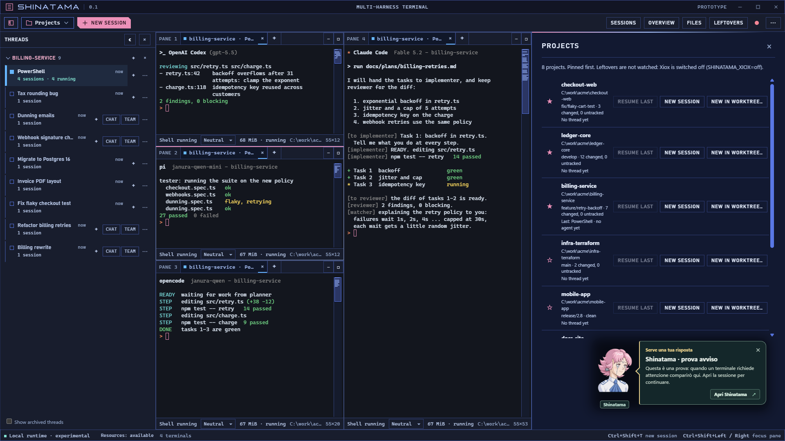
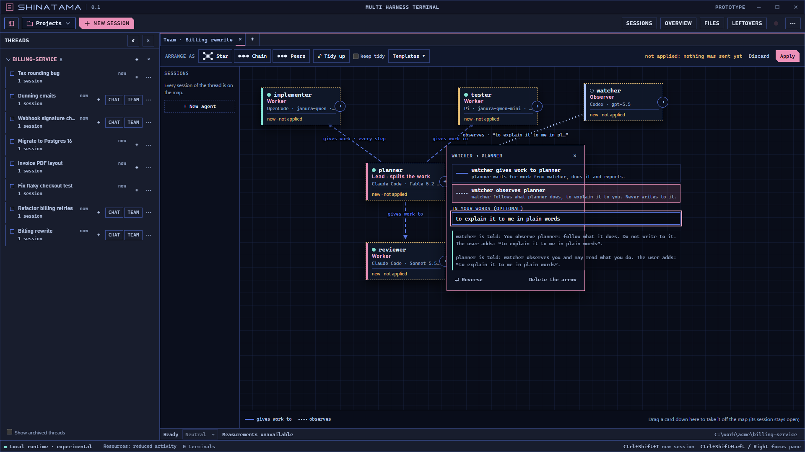
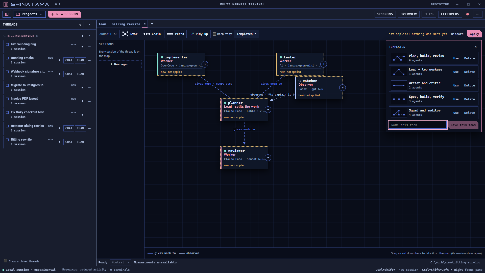

<h1 align="center">
  
</h1>

<p align="center"><strong>A desktop workspace for terminal coding agents.</strong></p>

<p align="center">
  <a href="#team-map">Team map</a> ·
  <a href="#quickstart">Quickstart</a> ·
  <a href="#supported-harnesses">Supported harnesses</a> ·
  <a href="#ecosystem">Ecosystem</a> ·
  <a href="#development">Development</a>
</p>

Run Claude Code and Codex side by side, keep a PowerShell pane for your own
commands, and hand off the relevant conversation context when you switch agents.
Shinatama hosts each harness in its native terminal interface and saves your
workspace layout locally.

<p align="center">
  
</p>

**Windows x64 · Early development.** The [verification register](docs/verification-register.md)
tracks which launch, resume, and handoff paths have been exercised.

## What you can do

- **Tile your terminals.** Split panes, move tabs, maximize a view, and search
  terminal output. Shinatama restores your layout when you reopen the app.
- **Keep work organized by project.** Pin repositories, see their Git status,
  return to a thread, or start a session in a new Git worktree.
- **Browse and export conversations.** Open local session archives in read-only
  mode and export conversations as Markdown, STX, or Mukade JSON.
- **Hand off a session.** Use **Hop** to preview the context sent to a new session
  in another harness. The current handoff starts the destination with a prepared
  prompt and leaves the source session intact.
- **See what needs attention.** The widget can take you to the relevant terminal.
  When system memory runs low, it shows the highest-usage terminal it measured
  and keeps existing sessions running. New terminals have a small startup
  memory check. [Memory policy](docs/notes/2026-11-12-interactive-memory.md)
- **Give a thread a team.** In a thread whose sessions talk to each other, the
  **Team** map shows the sessions as cards. Draw an arrow to say who *gives work
  to* whom, or who only *observes*; Shinatama works out each agent's role (lead,
  worker, observer), warns of loops and dead ends, and tells every session its place,
  once, through the thread's [Mukade](https://github.com/acaprino/mukade) room.
  Templates (Star, Chain, Peers or your own) and a model per agent let **Apply**
  open the sessions for you. [How the team map works](#team-map)
- **See what sessions leave behind.** With [Xiox](https://github.com/acaprino/xiox)
  beside Shinatama, the first agent session in a project starts `xiox observe` for it.
  The **Leftovers** side panel lists every worktree, copy of the repository, bench and
  backup folder, and session folder as it appears. It shows the size, the path and the
  session that made it, or the sessions that were open at the time. A new one raises the
  widget at once, so you can stop a session that keeps making copies. Shinatama never
  removes anything; Xiox's `xiox clean` command is there to copy.
  [How it works](docs/notes/2026-11-16-xiox-leftovers.md)

## Team map

<p align="center">
  
</p>

Turn on **Sessions talk to each other** in a thread's settings, then press **Team** on
its row. Drag the thread's sessions onto the map (or add an agent with no session yet), pull
the arrow of one card onto another, and click the arrow to say what it is:

| Relation | What the agents are told |
| --- | --- |
| **gives work to** | The giver hands out the work; the taker reports **when done**, **at every step**, or **only done / blocked**. Add your own words to the arrow. |
| **observes** | The observer follows what the other does to explain it to you. Mukade does not let it write. |

- **Roles are never typed.** Lead, worker, lead and worker, observer and peer follow from the
  arrows. The map refuses loops of work and observers that give or take work, and warns of
  two givers to one agent or of work for a stopped session.
- **Apply tells each session once.** Shinatama joins the thread's room as a host member, so
  each session reads its place as a message from you ("From the user, through shinatama").
  A change wakes only the sessions it concerns; applying again with nothing changed sends nothing.
- **Start from a template, or save yours.** *Arrange as* Star, Chain or Peers; the **Templates**
  menu saves a team and its shape. An agent can carry its own model, and **Apply** opens
  the sessions it still lacks (Claude Code, Codex, OpenCode or Pi).

<p align="center">
  
</p>

Needs the [Mukade](https://github.com/acaprino/mukade) program (v0.1.2 or later, pinned by Shinatama).
Design: [ADR-0058](docs/adr/ADR-0058-the-thread-team-map-and-telling-the-sessions.md) and the
[design spec](docs/superpowers/specs/2026-11-17-thread-team-design.md). Not yet exercised with real agents:
[checklist](docs/verification/2026-11-18-team-map-real-agents.md).

## Quickstart

From a Windows x64 checkout, install the Node version in [`.node-version`](.node-version)
and set up Rust with [rustup](https://rustup.rs/). The repository pins the
[toolchain](rust-toolchain.toml). Install the
[Tauri prerequisites for Windows](https://v2.tauri.app/start/prerequisites/#windows),
including the MSVC C++ build tools and WebView2.

```powershell
npm ci
npm run desktop
```

Select a project folder, then open **New session → PowerShell** to try the
workspace. To run agents from a source checkout, follow the
[sidecar setup](sidecar/source-build/README.md) for the pinned proxy and its
Node runtime. With those resources in place, choose an installed harness from
**New session** and complete any sign-in in its terminal. The portable build
includes the sidecar resources.

If you already have the local debug build and its helpers, double-click
[`Shinatama.cmd`](Shinatama.cmd). See the [Italian quickstart](AVVIO.md) for
the desktop controls and portable package details.

## Supported harnesses

| Harness | New session | Resume from Threads | Browse local archives |
| --- | --- | --- | --- |
|  [Claude Code](https://github.com/anthropics/claude-code) | Available | Available | Available |
|  [Codex CLI](https://github.com/openai/codex) | Available | Available | Available |
| <picture><source media="(prefers-color-scheme: dark)" srcset="docs/assets/harnesses/opencode-dark.svg"></picture> [OpenCode](https://opencode.ai/) | Available | Planned | Planned |
|  [Pi](https://pi.dev/) | Available | Planned | Available |

**Hop** can send context from Claude Code, Codex, or Pi to a different harness
listed above. Resume depends on an eligible saved thread. Hermes Agent and
DeepSeek Harness are planned integrations.

Every session of the four supported harnesses starts with **Marionette**, the
plugin built as an example of [Muro](https://github.com/acaprino/muro). The package ships a
pinned release, installed at the first start even offline; at each start Shinatama then follows
the latest `marionette-v<version>` release of [its own repository](https://github.com/acaprino/marionette/releases) and checks its SHA-256. Set
`SHINATAMA_MARIONETTE=off` to disable it. The local build also has an optional
display mod for supported Claude Code versions. [Marionette](AVVIO.md#marionette) ·
[Claude display mod](resources/claude-mods/README.md) ·
[Logo credits](docs/assets/harnesses/NOTICE.md)

## Ecosystem

| Project | Role |
| --- | --- |
| [**Mukade**](https://github.com/acaprino/mukade) | Rust library and CLI for reading, converting, and moving native agent sessions between harnesses. Shinatama uses Mukade to read sessions. The [handover design](docs/mukade-handover.md) covers native session transfer. |
| [**Xiox**](https://github.com/acaprino/xiox) | Windows cleaner for developers. Shinatama runs its `xiox observe` to list what agent sessions leave in a project; cleaning stays with `xiox clean`. |
| [**Muro**](https://github.com/acaprino/acaprinoprivate#readme) | Builds packages from skills and plugins. The host agent selects the capabilities it needs for each task. Repository access required. |

## Development

Shinatama uses **Rust** for the terminal engine, harness adapters, and local
SQLite state, with a **Tauri** desktop shell and a **TypeScript/xterm.js** UI.
See the [desktop app](apps/desktop) and [Rust crates](crates).

```powershell
npm run verify
```

The Windows verification runner builds the app and exercises real PTYs, desktop
controls, project restart, and storage. See the [verification guide](docs/implementation/windows-verification.md)
for prerequisites, individual checks, and CI artifacts.

- [Implementation plan](docs/implementation/PLAN.md) and [progress commands](docs/implementation/README.md)
- [Functional design](docs/functional-design.md) and [technical design](docs/technical-design.md)
- [Requirements](docs/frd/README.md) and [architecture decisions](docs/adr/README.md)
- [Browser integration proposal](docs/browser-integration.md) and [deferred Daodan integration](docs/daodan-native-support.md)

For bug reports, include your Windows version, the harness and its version if
relevant, and the steps to reproduce the issue. [GitHub Issues](https://github.com/acaprino/shinatama/issues)

## License

[Apache-2.0](LICENSE).
See the [third-party notices](THIRD_PARTY_NOTICES.md) for dependency licenses.
