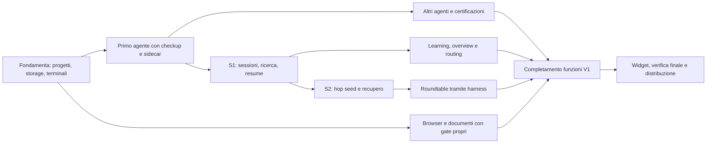

# Riprendere l'implementazione di Shinatama

**Piattaforma, decisione utente 2026-11-02:** solo Windows è supportato ufficialmente.
macOS e Linux sono [rinviati](2026-11-02-macos-linux-deferred.md): nessun passo attivo li richiede.

**Scope corrente, richiesta utente 2026-11-02:** integrazione Daodan rinviata.
I passi `D01`, `C34`, `C35`, `D02`, `D03`, `D04` restano `deferred` e si
riprendono solo su nuova indicazione. Non bloccano checkup generico, avvio degli
agenti, ricerca, hop, worktree o roundtable tramite harness. Restano conservati
i requisiti per una futura ripresa; il rinvio non e un risultato consegnato.

Eseguire dalla radice del repository:

```sh
python scripts/implementation.py status
```

Il [piano completo](PLAN.md) contiene la sequenza e la scheda di ogni incremento.
[plan.json](plan.json) contiene dipendenze e copertura FRD;
[progress.json](progress.json) conserva stato, prove eseguite, commit e azione successiva.
Il registro di verifica mantiene l'autorità sui gate: il piano non promuove le prove.

Le cinque fasi leggibili sono: fondamenta e progetti; primo agente supportato;
S1 ricerca/resume; S2 hop seed; estensioni V1 e distribuzione. Browser, roundtable,
Learning, routing, ottimizzazioni e widget hanno passi propri e verifiche esplicite.

**Priorita di resilienza, utente 2026-11-02:** il guasto di un subprocesso deve
restare confinato e i consumi richiedono calibrazione adattiva. Il passo C09R
introduce misure, budget e protezioni prima di C09/C13; l'arresto automatico del solo
responsabile e autorizzato come ultima difesa. Requisiti e prove ancora aperte:
[amendamento resilienza](2026-11-02-host-resilience.md), FRD-0001/R59-R63, RES1-RES4.



## Protocollo di ripresa

1. Leggere `progress.json`, eseguire `git status --short` e il comando `status`.
2. Aprire la scheda del passo indicato; leggere FRD, ADR e gate elencati.
3. Portare quel solo passo a `in_progress`; implementare e verificare il risultato utilizzabile.
4. Salvare prove e comandi realmente eseguiti; segnare `verified`, oppure il blocco concreto.
5. Preparare il commit con soli file/hunk del passo; dopo il commit annotare lo SHA reale e riprendere il prossimo passo pronto.

I checkpoint servono a riprendere e verificare il lavoro: non richiedono un nuovo
ordine per continuare. L'utente ha autorizzato l'implementazione del prodotto e
la prosecuzione autonoma degli incrementi pronti. Un blocco su un gate non ferma
le attività indipendenti; le prove mancanti restano aperte e non vengono inventate.

**Manutenzione DB, richiesta utente 2026-11-02:** C03M aggiunge job finiti,
conservazione esplicita, controllo dei dati malformati e limiti di crescita prima
di C09R. I dettagli sono nella [nota di manutenzione](2026-11-02-database-maintenance.md)
e in FRD-0014/R33-R37; un requisito aggiunto al piano non è ancora una funzione provata.

```sh
python scripts/implementation.py validate
python scripts/implementation.py render
python -m unittest discover -s scripts -p test_implementation.py
```

`validate` controlla tutti i requisiti Markdown, riferimenti, cicli, dipendenze,
stati, presenza delle evidenze e un solo passo attivo. Non esegue né inventa
le prove del prodotto. `render` aggiorna il documento leggibile dal piano e checkpoint.
Un passo attivo deve avere i prerequisiti verificati. Le attività evaluation/post-v1
richiedono un'autorizzazione esplicita registrata in `allow_non_v1`; non vengono
scelte automaticamente. Un commit indicato deve esistere realmente in Git.
`deferred` e distinto da evaluation/post-v1: non basta `allow_non_v1` per
riattivarlo, serve prima una nuova richiesta utente e l'aggiornamento dello scope.

## Regola dei commit iniziali

Il prototipo B00 era già presente ma non committato all'inizio di questo lavoro.
Il 2026-11-02 la richiesta esplicita `commit all` ha autorizzato il bootstrap
B00–B02 insieme al piano e agli emendamenti correnti delle specifiche, nel commit
`266fb1e043f834f0cf4a2e71976028d5f54c2186`. I tre checkpoint registrano questo SHA
reale condiviso; non sono stati inventati commit storici separati.

Dal passo successivo: un incremento funzionale per commit, con titolo e ambito
indicati nella scheda. Se un incremento aggrega piu unita di commit, seguirle
nell'ordine registrando ciascuna sotto `steps.<id>.units.<unita>`; il padre diventa
verificato soltanto quando tutte le unita lo sono. Nessun commit supera una
singola unita di lavoro senza un motivo registrato nel checkpoint.
Nessun `git add .`, reset o pulizia del lavoro altrui.

## Checkpoint corrente

- F32CI: runner unico locale/CI Windows, inventario/notice e prove locali completate;
  eseguire `npm run verify`. Il primo run remoto GitHub rimane prova separata.

- TL1: shell Tauri provata su Windows con Claude Code reale, annidamento, Markdown e file. ADR-0002 v4 e ADR-0040 v2 sono Proposed, non approvati automaticamente.
- C01: percorsi dati privati e controlli Windows implementati; SQLite segue in C02. Le qualifiche complete dei provider sincronizzati restano aperte.
- B00: prototipo Tauri borderless con terminali reali, verificato su Windows.
- B01: piano completo e validatore riprendibile; stato autorevole in `progress.json`.
- B02: cronologia progetti e ripristino, con prova su due avvii reali.

Il prossimo passo effettivo si ottiene sempre con `status`, senza dedurlo da
questa descrizione. Le stime nelle schede sono intervalli di ore di lavoro,
da aggiornare quando un'integrazione supera o fallisce la propria prova.
