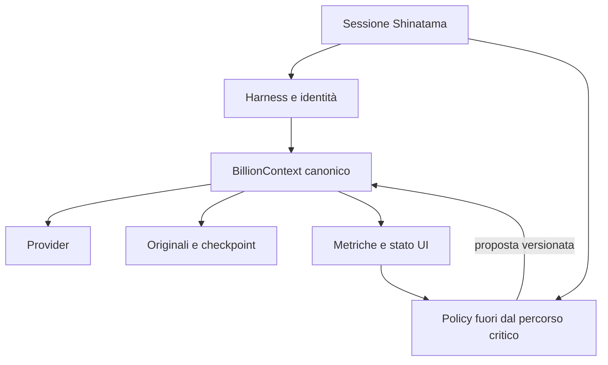

# BillionContext in Shinatama: studio di integrazione, intenti e stabilità

Data: 13 novembre 2026. Stato: **studio e proposta tecnica; non modifica la configurazione né abilita nuove funzioni**.

Base osservata: Shinatama `68ebb87f154d1b4e276d6ec4987272fded7599c4`, più il working tree già modificato all'inizio dell'analisi. Le modifiche preesistenti non sono state alterate. BillionContext preparato: `0.1.207`, upstream `7e69b49ff4facb00b5ba6541b48d0f7fbe63d63d`, source tree `68d08d963cc1e081f6605677db824db62d3eddc1c3ec7126e444fdc9cd885579`. Il numero di versione non identifica da solo il codice incorporato.

Il nome corretto è **BillionContext**; con “CRR” interpreto **CCR, Content Cache & Retrieve**, la funzione presente nel progetto.

## 1. Conclusione operativa

**BillionContext è una base adatta, ma il risparmio affidabile richiede un controllo di qualità e compatibilità intorno al motore, non semplicemente soglie più basse.** Shinatama dispone già di isolamento, supervisione, compressione gerarchica, CCR, steering e gestione delle immagini. Non dispone ancora di una politica completa che distingua ricerca, scrittura, sviluppo, debugging e confronto visivo, né di prove sufficienti per dichiarare un risparmio complessivo su ogni harness.

La proposta è:

1. Mantenere BillionContext come **unico proprietario della trasformazione delle richieste**. Shinatama gestisce intenzione, identità, budget, osservabilità e ciclo di vita.
2. Separare **cosa serve ricordare**, **quanto contesto è disponibile** e **quanto deve essere estesa la risposta**. Sono tre decisioni diverse.
3. Preferire prevenzione, deduplicazione esatta e archiviazione recuperabile; ricorrere ai riassunti soltanto con originali disponibili e vincoli protetti.
4. Applicare modifiche alla storia a confini stabili, sfruttando le epoche già presenti nel codice. Evitare una nuova riscrittura del prefisso a ogni turno.
5. Attivare una trasformazione soltanto sulle combinazioni harness/protocollo/modello per cui il recupero e il formato sono verificati.
6. Rendere opzionale e fallibile il nuovo decisore di policy: se non risponde, la sessione prosegue con la precedente proiezione valida. Non deve diventare un'altra dipendenza necessaria a ogni turno.
7. Misurare **costo totale e qualità del compito completato**, includendo recuperi, riassunti, tentativi falliti e chiamate ausiliarie.

“Non deve mai interferire negativamente” va tradotto in invarianti, isolamento e verifiche. Non è dimostrabile come promessa assoluta per un proxy posto nel percorso di rete. È invece verificabile che una policy guasta non corrompa la sessione, non ripeta azioni, non alteri permessi e non fermi altre sessioni. La perdita del processo proxy può comunque interrompere una connessione: va gestita esplicitamente, senza promettere continuità che il codice non garantisce.

### Come leggere lo studio

| Serve capire… | Leggere |
|---|---|
| Cosa funziona oggi e cosa manca | §§2–3 |
| Quale compressione usare per ciascun lavoro | §§4–7 |
| Come gestire steering, CCR e immagini | §§7–9 |
| Come mantenere stabile Shinatama | §§10–11 |
| Come misurare il beneficio e decidere il rilascio | §§12–14 |
| Le prove puntuali nel codice | [Audit compressione](2026-11-13-billioncontext-compression-audit.md) e [audit integrazione](2026-11-13-billioncontext-integration-audit.md) |

Le affermazioni sono distinte in **osservato nel codice**, **evidenza storica** e **proposto**. Nessuna percentuale teorica o pubblicizzata è presentata come risultato ottenuto su Shinatama.

## 2. Cosa è già presente

### 2.1 Baseline effettivamente scritta per nuove configurazioni

`crates/engine/src/sidecar_config.rs:152` prepara questa politica:

| Impostazione | Valore | Conseguenza reale |
|---|---|---|
| Aggiornamenti automatici | Disabilitati | Il codice non cambia autonomamente durante il lavoro |
| Storage | Unified full, SQLite | Gli originali e lo stato dipendono da persistenza e recupero corretti |
| `promptRewrite.mode` | `auto` | Può migliorare un prompt umano; non significa necessariamente accorciarlo |
| `compress.tiers` | `true` | Disponibilità della compressione gerarchica |
| `compress.absorb` | Abilitato, minimo configurato 4.000 token | Il resolver Bili imposta `mediaOnly=true`; i media hanno condizioni specifiche e possono bypassare tale soglia |
| `compress.ccr` | Abilitato, minimo 4.000 token | L'abilitazione richiesta non garantisce che la specifica lane lo ammetta |
| `adaptivePressure` | Abilitato, `maxTokens: 160000` | Politica di pressione; 160.000 non è una finestra universale né un taglio rigido |
| Output steering | Abilitato, livello 2 | Direttiva di concisione aggiunta al prompt di sistema |
| `effortRouting` | `false` | Nessuna riduzione automatica dell'effort tramite questa leva |

**Le configurazioni già esistenti vengono preservate.** Il generatore usa `create_new` e non sovrascrive un file già presente. Quindi i valori sopra non certificano una sessione già avviata; occorre leggere la configurazione risolta dal processo e le condizioni della richiesta. [L1]

### 2.2 Intenzione: oggi due profili strutturali

Il file `src/musashi-terminal/context-profiles.ts` del sidecar contiene:

| Profilo | Soglia `maxContextLimit` | Messaggi recenti preservati | Token recenti preservati | Crescita per nudge |
|---|---:|---:|---:|---:|
| `analysis` | 65% | 12 | 16.000 | 30.000 |
| `build` | 45% | 6 | 6.000 | 15.000 |

La selezione usa segnali del client: agente dichiarato dal plugin, modalità native Plan/Default di Codex, chiamate completate EnterPlanMode/ExitPlanMode di Claude. Non classifica liberamente il testo umano. Incertezza o conflitto ricadono su `analysis`. È una scelta prudente contro segnali ambigui, ma **“Default” non equivale sempre a coding**: una sessione di scrittura in quella modalità può ricevere `build`.

I profili sovrascrivono soltanto cinque campi di soglia/ritenzione. Non contengono una policy semantica per citazioni, bozze, immagini o output. La precedenza è globale → profilo → provider → modello; un override profondo può annullare la soglia del profilo. `adaptivePressure` resta globale nel merge attuale. Un profilo selezionato non significa quindi che tutte le sue soglie siano quelle operative. [L3]

### 2.3 Meccanismi da non confondere

| Meccanismo | Cosa fa | Limite da considerare |
|---|---|---|
| CCR | Archivia contenuti voluminosi e lascia riferimenti, con recupero | Il modello deve poter usare davvero il canale di recupero |
| `compress`/tiers | Rappresenta intervalli della storia con sintesi gerarchiche | La sintesi può omettere dettagli; originali accessibili non garantiscono che vengano cercati |
| `absorb` | Sostituisce risultati selezionati con un distillato | Non va trattato come trasformazione semanticamente senza perdita |
| Adaptive pressure/epoche | Decide quando fare emergere modifiche della vista | Non è un ottimizzatore economico basato sui prezzi reali |
| Output steering | Cerca di evitare testo superfluo generato | Può ridurre anche spiegazioni richieste se applicato troppo aggressivamente |
| Prompt rewrite | Aggiunge una nota con la richiesta corretta e organizzata, lasciando l'originale | Può aumentare l'input e aggiunge una chiamata/attesa |
| Media folding/rescale | Riduce immagini nella vista o nella rappresentazione inviata | Recuperabilità, dettaglio visivo e cache vanno verificati separatamente |
| Ledger Shinatama | Legge usage, cache, compaction e ripetizioni dai record nativi | Non è ancora una contabilità completa delle trasformazioni del proxy |
| Decision planner Rust | Produce keep/truncate/remove su coppie tool-call/result | Esiste come componente locale; non risulta collegato al percorso operativo |

Nel pin, `priceProfile` alimenta report e non i trigger di compressione. Il gate di beneficio osservato usa dimensioni del contenuto, non un break-even in euro. `adaptivePressure.targetRatio` e `growthWindow` sono parsati ma non consumati dal percorso osservato; Shinatama li ha già omessi dalla baseline. Non devono comparire come controlli apparentemente efficaci nella UI. [L1, L4, L5, A1]

## 3. Rischi prioritari emersi

| Priorità | Osservazione | Effetto possibile | Intervento proposto |
|---|---|---|---|
| P0 | CCR configurato ma disarmato su determinate lane | UI rassicurante, beneficio assente o recupero non disponibile | Stato per sessione `richiesto / effettivo / verificato` e reason code |
| P0 | Il pulsante Stop del servizio è disponibile anche nello stato Ready, senza controllo delle sessioni attive in quella UI/controller | Interruzione del proxy necessario agli agenti | Separare arresto da pausa ottimizzazione; drain basato su richieste reali |
| P0 | Non risulta un bypass strutturale completo per messaggi di controllo/hop | Riscrittura o archiviazione di istruzioni che devono arrivare esatte | Metadati affidabili e test byte-per-byte, implementati nella sorgente canonica |
| P0 | Le prove locali di supervisione non coprono tutta la matrice e il soak SC16 | Stabilità sovrastimata sotto carico e con storia lunga | Chiudere i test mancanti prima di nuove politiche aggressive |
| P1 | Profili solo analysis/build | Trattamento improprio di scrittura o revisione visiva | Nuovo contratto d'intento separato dalla modalità dell'harness |
| P1 | L3/L4 possono eliminare rationale | Peggioramento di analisi, spiegazioni e testi estesi | Livelli prudenti e protezione esplicita del deliverable |
| P1 | Recupero immagini dipende anche da indice/spill temporanei | Un originale può non essere recuperabile quando richiesto | Manifest persistente e recupero end-to-end dopo riavvio |
| P1 | Il rescale usa `jimp`, assente dalle dipendenze incluse nel bundle preparato osservato | Funzione apparentemente attiva ma che può tornare all'originale | Prova di risoluzione nel runtime isolato; capability realmente osservata |
| P1 | Planner con euristiche ancora non cablate | Una futura attivazione ingenua può eliminare prove utili | Revisione delle euristiche e archiviazione prima di truncate/remove |
| P2 | Ledger incompleto per chiamate interne/media/pricing | Risparmio conteggiato due volte o costo nascosto | Eventi del proxy correlati alle richieste native |

Questa tabella è un ordine di lavoro, non la dichiarazione che tali effetti si siano tutti verificati nell'app. Le prime due note di audit riportano condizioni e righe precise. [A1, A2]

### CCR: distinguere harness e protocollo

Nel pin osservato:

- Il percorso riconosciuto come **Codex host** disarma CCR per incompatibilità con strumenti iniettati.
- In modalità plugin, CCR è ammesso su wire Anthropic/OpenAI Chat; non si può estendere automaticamente tale conclusione a Responses o Google.
- Responses in proxy generico ha altre condizioni, fra cui disponibilità dell'iniezione tool e del relativo canale. Non è equivalente a Codex.
- `enabled=true` nel JSON è pertanto una **richiesta di configurazione**, non una prova di esecuzione.

La disattivazione non significa che tutta la compressione sia spenta: tiers, gestione della storia e altre funzioni hanno gate distinti. È necessario esporre capacità distinte, non una sola spunta “BillionContext attivo”. [A1]

## 4. Architettura raccomandata

### Alternative valutate

| Approccio | Vantaggio | Limite | Valutazione |
|---|---|---|---|
| Solo configurare meglio l'attuale baseline | Poco codice e rischio contenuto | Non risolve intenti multipli, telemetria e protezione semantica | Prima fase utile, non soluzione completa |
| Controller di policy in Shinatama, esecuzione nel BillionContext canonico | Riusa persistenza/protocolli, policy verificabile per sessione | Richiede un contratto tra host e sidecar e prove nuove | **Raccomandato** |
| Secondo proxy/compressore indipendente | Prototipo apparentemente veloce | Due trasformazioni della storia, cache e recupero da coordinare | Da escludere nel progetto |



**Responsabilità proposte:**

| Componente | Responsabilità | Non deve assumersi |
|---|---|---|
| Shinatama engine | Identità, intenti, limiti di risorse, supervisione e policy persistita | Riscrivere direttamente body HTTP o protocolli provider |
| Controller policy | Classificare candidati, costruire manifest e suggerire azioni | Gestire credenziali, autorizzare tool, decidere retry di rete |
| BillionContext | Validare e applicare trasformazioni, recuperare originali, gestire il wire | Prendere il significato di un testo non fidato come configurazione |
| Adapter harness | Eventi e segnali nativi, handshake capability | Inventare supporto sulla base del nome del modello |
| UI | Mostrare stato effettivo, motivi, recuperi e impostazioni semplici | Dedurre risparmio da token stimati o heartbeat |

Ogni modifica al percorso delle richieste va nella sorgente canonica posseduta, poi entra in Shinatama tramite aggiornamento verificato del pin. Non modificare i file sotto `prepared` come implementazione definitiva: sono un artefatto di preparazione. [L2]

## 5. Contratto dell'intento

### 5.1 Tre dimensioni indipendenti

Una sessione può avere intento principale `analysis` e fase corrente `verification`, mentre la risposta richiesta è un report dettagliato. Non è corretto ridurre tutto a un singolo enum “coding/non coding”.

Schema concettuale proposto, **non chiavi già accettate dalla configurazione BillionContext**:

```json
{
  "schemaVersion": 1,
  "sessionId": "stable-native-session-id",
  "policyRevision": 12,
  "baseRevision": "opaque-transcript-revision",
  "intent": "analysis",
  "phase": "verification",
  "deliverable": "detailed-report",
  "source": "explicit-user",
  "confidence": 1.0,
  "preservation": ["constraints", "evidence", "citations", "open-questions"],
  "outputPolicy": "full-deliverable-concise-progress",
  "capabilityRevision": "qualified-adapter-revision"
}
```

Il controller deve ricevere soltanto metadati e porzioni necessarie; non serve inviare la storia completa a un classificatore a ogni turno. Un eventuale modello piccolo locale lavora su delta e non è autorità finale. Si applicano prima le regole deterministiche.

### 5.2 Precedenza e cambiamenti

Ordine proposto: scelta esplicita dell'utente → metadati del task creati dall'host → segnali nativi → classificatore con confidenza → conservativo/misto.

“Esplicito dell'utente” deve provenire dall'evento umano autenticato o da un controllo UI; il testo letto da un file o ricevuto da un tool non può cambiare policy. Non interpretare intestazioni trovate nei documenti come comandi di sessione.

Al cambiamento di intento:

1. Conservare l'identità e il checkpoint corrente.
2. Registrare un nuovo `policyRevision` e le evidenze del cambiamento.
3. Invalidare proposte di compressione costruite sulla revisione precedente.
4. Applicare la nuova selezione ai candidati futuri a un confine di turno sicuro.
5. Recuperare i blocchi necessari al nuovo lavoro; non ricomprimere tutta la storia automaticamente.
6. Non cambiare automaticamente effort, modello, tool set o vecchio system prompt.

Isteresi proposta: una dichiarazione umana cambia subito l'intento; l'inferenza richiede evidenza persistente su due turni umani o una transizione di task esplicita. I valori di confidenza sono soglie da calibrare, non probabilità affidabili per definizione. In caso di conflitto vince la policy che conserva più informazione.

### 5.3 Politiche per tipo di lavoro

| Intento | Da mantenere esatto | Candidati prioritari | Recupero prima di… | Output consigliato |
|---|---|---|---|---|
| Analisi/ricerca | Domanda, ipotesi aperte, prove contrarie, fonti, cifre, limiti | Duplicati, navigazione, estratti già referenziati | Conclusioni, citazioni e confronti basati sui dettagli | Spiegazione completa; progressi brevi |
| Coding | Requisiti, firme, file/simboli attivi, diff, errore attuale | Listing, letture duplicate dello stesso contenuto, log riusciti ridondanti | Edit basati su contenuto archiviato o riferimenti di linea vecchi | Modifiche e validazione complete, poca ripetizione |
| Debugging | Riproduzione, stacktrace, ambiente, timeline, ipotesi escluse | Tentativi ripetitivi, output di successo non discriminanti | Dichiarazione della causa e verifica della correzione | Causa e prova, non soltanto “risolto” |
| Scrittura/editing | Brief, tono, destinatario, testo da correggere, citazioni, versione scelta | Bozze sostituite e alternative esplicitamente scartate | Revisione puntuale, confronto di versioni o restituzione integrale | Testo richiesto per intero; niente limite implicito di lunghezza |
| Pianificazione | Decisioni, dipendenze, vincoli, criteri di completamento | Proposte scartate dopo averne registrato motivo e conseguenze | Cambio di piano o stima basata su assunzioni precedenti | Piano leggibile con trade-off utili |
| Review | Diff, base di confronto, file coinvolti, evidenze dei finding | Ricerche già escluse e contesto non pertinente | Segnalare difetti e proporre patch | Finding con posizione, impatto e prova |
| Documenti/UI/visivo | Immagine attuale, riferimento, coordinate, layout atteso, pagina | Render superseded e duplicati esatti | Confronto visivo, crop, misura, verifica finale | Spiegazioni sufficienti e immagini necessarie |
| Misto/sconosciuto | Unione dei vincoli dei lavori attivi | Soltanto ridondanza esatta e materiali sicuramente conclusi | Qualsiasi decisione dipendente da dettagli rimossi | Impostazione conservativa |

Un file letto prima di essere modificato non è automaticamente inutile: può essere la prova del bug originale o la base richiesta per una review. Una bozza scartata non è automaticamente irrilevante: il motivo dello scarto può essere un vincolo del testo finale.

## 6. Politica di conservazione e compressione

### 6.1 Quattro classi di informazione

| Classe | Esempi | Regola proposta |
|---|---|---|
| Controllo | Permessi, interruzioni, routing, handoff, seed, receipt | Non riscrivere; bypass strutturale e identità verificata |
| Contratto del task | Obiettivo, vincoli, decisioni, domande aperte | Pinned o registro compatto con rimandi agli originali; nessuna perdita delle eccezioni |
| Materiale di lavoro | Codice, prove, bozze, immagini e dati | Ritenzione per intento/fase; archiviazione verificata prima della riduzione |
| Materiale esaurito | Duplicati esatti, listing già usati, render sostituiti | Primo candidato, se non è l'unica prova di un fatto |

L'età è un segnale secondario. La regola “butta tutto dopo N turni” non distingue una schermata inutile da una clausola fondamentale.

### 6.2 Manifest degli elementi protetti

Il manifest dovrebbe contenere riferimenti, hash, motivi e stato; non una copia integrale del transcript:

- obiettivo e deliverable correnti;
- vincoli, eccezioni e divieti con il messaggio sorgente;
- decisioni adottate e ragioni indispensabili;
- ipotesi ancora aperte, prove controverse e domande pendenti;
- file, revisioni, artefatti e immagini attualmente coinvolti;
- chiamate tool pendenti, approvazioni in corso e ultimo esito di verifica;
- autorità della fonte: utente, sistema, strumento o sintesi dell'assistente.

Il manifest non può trasformare un'ipotesi dell'assistente in una decisione dell'utente. Gli originali restano l'autorità. Un identificatore di linea va associato alla revisione del file: dopo un edit la stessa linea può indicare altro.

### 6.3 Ordine delle trasformazioni

1. **Prevenire ingresso inutile:** range di righe, filtri, selezione colonne, ricerca indicizzata, output strutturato, tool/skill caricati quando servono.
2. **Deduplicare esattamente:** medesimo contenuto/hash e medesimo significato/versione. Ripetere lo stesso comando non implica lo stesso risultato.
3. **Archiviare con CCR:** contenuto integro su storage verificato, descrizione utile e riferimento recuperabile.
4. **Produrre digest specifici:** log test → errori e riepilogo; diff → file/simboli/rimandi; ricerca → risultati pertinenti con provenienza. Il parser non elimina l'unica evidenza negativa.
5. **Comprimere blocchi di attività concluse:** sintesi con contratto strutturato e citazioni agli originali.
6. **Distillare livelli precedenti:** soltanto con link attraversabili fino agli originali e budget di degradazione della sintesi.
7. **Emergenza:** rispettare i limiti reali del provider; se i contenuti protetti da soli non entrano, dichiarare il limite e proporre checkpoint/handoff. Non scartare silenziosamente requisiti per continuare.

Non impilare tre compressori lossy sullo stesso blocco. Ogni trasformazione deve sapere da quale originale e da quale generazione deriva la propria vista.

### 6.4 Selezione dei candidati

Per ciascun blocco, raccogliere: dimensione stimata, provenienza, versione, stato del task, ultima citazione, unicità dell'evidenza, presenza di errore, pin esplicito, costo di recupero, frequenza dei recuperi e disponibilità dell'originale.

Un punteggio possibile è:

`beneficio atteso − costo di recupero − rischio semantico − costo di invalidazione cache`

È un ordinamento progettuale, non una funzione già implementata. I vincoli duri precedono il punteggio: una chiamata pendente, un'approvazione o un originale mancante non diventano eliminabili perché molto grandi. L'incertezza dà `keep`, non `remove`.

Pseudocodice proposto:

```text
snapshot = leggi_revisioni_sessione_policy_capability()
if capability_non_verificata or archivio_non_sano:
    conserva_proiezione_valida()
else:
    candidati = seleziona_blocchi_conclusi_non_protetti(snapshot)
    proposte = valuta_fuori_dal_percorso_critico(candidati)
    al_confine_di_turno:
        scarta_proposte_obsolete()
        verifica_originali_e_recupero()
        verifica_coppie_tool_e_invarianti_protocollo()
        verifica_budget_e_beneficio()
        applica_una_transazione_versionata_nel_motore_canonico()
```

Il worker può lavorare in anticipo; una chiamata al modello classificatore non deve sospendere la richiesta principale. Una proposta arrivata tardi è ignorata, non applicata retroattivamente al turno in corso.

### 6.5 Limiti del planner già presente

`crates/token-economy/src/decision.rs` è una buona separazione tra decisione e applicazione, ma non è pronto per essere acceso indiscriminatamente:

- il target di una chiamata non è un hash dell'output: stesso comando può produrre prove differenti;
- “letto e poi modificato” non prova che il vecchio contenuto non serva;
- `protected()` usa parole chiave e una soglia di 4.000 byte: non è un riconoscitore completo dei vincoli;
- il criterio “ripetuto dopo” precede “citato dopo” nelle decisioni osservate;
- la troncatura avvisa di rieseguire il tool, ma non assicura il recupero dello stesso originale;
- byte rimossi non sono token risparmiati né soldi risparmiati.

Poiché il componente non è cablato nel percorso operativo, questi sono requisiti prima della futura attivazione, non regressioni dimostrate nelle sessioni attuali. La riesecuzione è accettabile soltanto per letture ripetibili e innocue; per scritture, pagamenti, invii, comandi con effetti o dati volatili occorre recuperare il risultato registrato. [L5, A2]

## 7. CCR e recupero: il contratto che rende utile la compressione

**Archiviare è senza perdita soltanto a livello di storage. La decisione del modello può comunque perdere qualità se non sa che un dettaglio mancante deve essere recuperato.** Occorre progettare anche la reperibilità.

### Regole proposte

| Punto | Regola |
|---|---|
| Prima dell'archiviazione | Persistenza riuscita e indirizzo di recupero valido |
| Placeholder | Tipo, origine, versione, dimensione, breve contenuto discriminante, ref stabile |
| Isolamento | Ref legato a sessione/namespace autorizzato; niente ricerca implicita in altre sessioni |
| Ricerca | Testuale e per metadati; eventuale reranking deve lasciare accessibili tutti gli originali |
| Recupero | Preferire span, pagina o regione pertinenti all'intero blocco |
| Recuperi ripetuti | Promuovere temporaneamente il contenuto a working set, con limite; evitare retrieve/fold continuo |
| Errore di recupero | Nessuna invenzione; mantenere o restaurare la vista valida e segnalare il limite |
| Eliminazione | Nessuna garbage collection di originali ancora referenziati da sessioni/checkpoint vivi |
| Privacy | Originali e metadati nei root privati; diagnostica senza payload, credenziali o URL sensibili |

Esempio di descrittore, da considerare schema di design e non formato nativo già supportato:

```text
ref: r42; tipo: test-log; task: fix-resume
origine: cargo test resume; revisione: abc123
segnale: 1 failure, resume_owner_conflict; stacktrace e assertion disponibili
recupero: r42/error-section; originale-sha256: …
```

Un semplice estratto iniziale può omettere l'errore che compare in fondo a un log. La soglia di 4.000 token è un punto iniziale, non una legge: l'archiviazione di un risultato che verrà subito riletto aggiunge un round-trip e può peggiorare le prestazioni. Partire dalla soglia attuale, misurare recuperi e modificarla soltanto per gruppi di strumenti verificati.

Per citazioni, patch, dettagli numerici, confronti o prove controverse, il criterio è **recuperare prima di impegnarsi sulla conclusione**. Non imporre una rilettura preventiva di tutti gli originali: annullerebbe il beneficio.

## 8. Steering e risparmio dell'output

### 8.1 I livelli reali

Il campo si chiama `verbosityLevel`, ma un numero maggiore produce direttive di **maggiore concisione**:

| Livello | Comportamento nel pin | Uso proposto |
|---|---|---|
| L0 | Nessuna direttiva di verbosità | Testo creativo, trascrizione, restituzione integrale, esigenze incompatibili con steering |
| L1 | Elimina introduzioni e riepiloghi rituali | Analisi e scrittura dove servono spiegazioni |
| L2 | Aggiunge il divieto di ripetere codice/output già visto | Coding ordinario; baseline attuale |
| L3 | Conclusioni senza rationale salvo richiesta, prosa minima | Soltanto task meccanici esplicitamente brevi e qualificati |
| L4 | Frammenti e minimo testo | Non adatto come default generale |

La direttiva è congelata e aggiunta alla coda del system prompt. Non va sostituita continuamente in base a ciascun tool result. La prova T6 conferma cache stabile dopo l'assestamento nel caso limitato testato; abilitare a metà sessione causa una riscrittura della storia nella cache. T6 non misura il risparmio sulle risposte reali. [L6, L7]

### 8.2 Proteggere il deliverable

La policy futura deve distinguere:

- **progressi operativi:** brevi, senza ripetere l'output di strumenti;
- **contenuto richiesto:** completo nella forma richiesta, anche quando lungo;
- **spiegazioni necessarie:** motivazioni, prove, limiti e passaggi che evitano ambiguità;
- **tool call e dati strutturati:** mai tagliati da un filtro testuale di output.

Non troncare il testo generato in streaming per risparmiare: i token sono già stati generati e si rischia di spezzare codice, JSON, citazioni e protocollo. Il risparmio va ottenuto nella generazione; la presentazione UI può essere compatta senza modificare il contenuto conservato.

Per una nuova sessione si può scegliere un livello prudente coerente con il compito. Per un cambio di fase in una sessione esistente, preferire indicazioni append-only attraverso canali supportati oppure lasciare il livello invariato. Una nuova direttiva universale “deliverable completo, progressi concisi” sarebbe un aggiornamento versionato del prompt, da qualificare; non un cambio silenzioso del testo congelato.

### 8.3 Effort: mantenere il blocco attuale

`effortRouting:false` è una decisione preesistente del progetto e resta la raccomandazione. Un tool result può richiedere molto ragionamento: una traccia di errore nuova non è un'operazione meccanica solo perché arriva da un tool.

Le documentazioni attuali descrivono meccanismi append-only specifici: per-message effort per modelli Anthropic supportati e `configuration_update` per modelli OpenAI compatibili. Questo non dimostra che il pin li implementi né che il client intermediario li accetti. Le eventuali prove devono distinguere supporto, qualità, cache e risparmio netto. [E1, E2]

Non cancellare o ricostruire a mano blocchi thinking firmati o campi opachi. Le regole cambiano per protocollo: DeepSeek, per esempio, richiede di ritrasmettere il reasoning nei flussi con strumenti secondo il suo contratto. Un campo di reasoning non è testo generico comprimibile. [E4]

### 8.4 Prompt rewrite: utilità distinta dal risparmio

Il contratto canonico chiede di preservare lingua, intenzione, autorizzazioni, negazioni e letterali; consente un risultato più lungo quando migliora la chiarezza. Il percorso **aggiunge una nota user adiacente e mantiene l'originale**, ripetendo la nota stabilmente nei turni successivi. Ha un deadline fino a 3 secondi e rinuncia alla nota in varie condizioni di errore. La validazione dei letterali non prova da sola equivalenza semantica completa. È quindi una funzione di chiarificazione, con costo e latenza, non compressione del prompt né una prova di token saving. [L8, A1]

Proposta: renderne visibili costo/attesa e motivo di applicazione; escludere strutturalmente controllo/handoff, testi esatti, citazioni, codice e consegne “restituisci questo testo”. Per dettature confuse può essere utile, ma non deve ampliare la richiesta, trasformare una domanda in autorizzazione o eliminare una precisazione. In caso di incertezza, conservare il testo originale. Il cambiamento dalla baseline `auto` richiede una decisione esplicita di prodotto, non una migrazione nascosta durante questo studio.

## 9. Immagini, PDF e lavoro visivo

### 9.1 Non tutte le immagini vecchie sono inutili

| Caso | Trattamento proposto |
|---|---|
| Screenshot duplicato identico, stessa revisione e scopo | Deduplicazione deterministica |
| Vecchio render sostituito e non usato nel confronto | Archiviazione dopo verifica dell'originale |
| Screenshot corrente durante computer use | Protezione fino a completamento/verifica dell'azione |
| Prima/dopo, riferimento grafico, due varianti da confrontare | Proteggere entrambi e l'associazione |
| Documento con testo minuto, tabelle, scansione o diagramma | Conservare dettaglio necessario; crop mirato se appropriato |
| Immagine decorativa in un risultato estraneo al task | Candidata alla rimozione dalla vista, originale preservato |
| PDF nativo come file/document block | Gestione specifica: non assumere che sia una lista di image blocks |
| Crop di una sorgente | Conservare coordinate, scala, orientamento e legame all'originale |

OCR e descrizione testuale sono indici utili, non sostituti universali dell'immagine. Per layout, colori, grafici, formule o immagini mediche possono perdere informazione essenziale. Un hash percettivo serve a proporre duplicati, non a dichiararli uguali.

### 9.2 Il pin attuale ha più percorsi

Sono presenti media folding, un backstop sul peso in byte e rescale. Non equivalgono a un'unica funzione “rimuovi immagini dopo N turni”. Il vecchio `stripImages` non va riproposto come controllo: le riscritture scorrevoli possono danneggiare la cache. [A1]

Il rescale ha configurazione predefinita, ma il bundle preparato osservato include Zod e non `jimp`, mentre il codice conserva un import dinamico di quest'ultimo. La degradazione torna agli originali: **non si può dichiarare il ridimensionamento operativo senza provarlo nel runtime isolato effettivo**. Anche se funziona, ridurre byte JPEG non dimostra una riduzione dei token visivi. [A1]

Il percorso di recupero degli originali visivi passa anche da indici della richiesta e file temporanei con TTL. L'indice viene ricostruito dal body corrente; i file possono essere rigenerati quando i pixel sono ancora disponibili. Lo storage unified può rilasciare i riferimenti media dei messaggi ritirati: non va quindi descritto come archivio permanente recuperabile sempre dopo restart, fork o giorni di inattività. Una prova deve eliminare la dipendenza dalla memoria del processo e verificare il recupero tramite ref quando il client non ritrasmette più i pixel originali. [A1]

### 9.3 Manifest immagini proposto

Per ogni immagine: `imageId`, hash originale, tipo MIME, dimensioni, sorgente/pagina, revisione dell'artefatto, frame o crop, scopo, token stimati per provider, stato protetto/archiviato, ref originale, derivati e policy applicata. Le descrizioni generate sono non autorevoli e non possono autorizzare la cancellazione della sorgente.

Folding a confini di epoca; niente cambiamenti continui di risoluzione o `detail` per immagini già parte del prefisso. Per una nuova immagine, scegliere il dettaglio in base al compito e al modello. Le guide dei provider descrivono contabilità e preprocessing diversi: l'unità “byte di base64” non è una tariffa universale. [E1, E5]

Se un'operazione ha bisogno di leggere testo minuto o confrontare pixel, promuovere l'originale prima di procedere. Un errore di accesso deve mantenere l'immagine corrente o bloccare la sola ottimizzazione, non sostituire silenziosamente la prova visiva con una descrizione.

## 10. Stabilità: invarianti e degradazione

### 10.1 Invarianti proposte

1. **Identità:** sessione, ramo, harness, provider e namespace di recupero non sono dedotti soltanto dal contenuto del prompt.
2. **Isolamento:** una policy di una sessione non cambia quella di un'altra; niente override globali per implementare una scelta per sessione.
3. **Integrità:** tool-call/result, ID, sequenza eventi, firme e campi opachi restano validi.
4. **Durabilità:** originale persistito prima che il riferimento ne diventi l'unica rappresentazione inviata.
5. **Versioni:** una proposta si applica soltanto allo snapshot da cui deriva; conflitto → scarto, non tentativo di adattamento cieco.
6. **Nessuna doppia azione:** il controller di compressione non riesegue tool; il recupero legge dati, non ripete effetti.
7. **Permessi:** nessuna compressione modifica sandbox, conferme, ruoli o autorizzazioni.
8. **Risorse limitate:** CPU, memoria, spazio, code e tempo del decisore sono limitati; diagnostica e scoring non rallentano l'interfaccia.
9. **Un supervisore:** nessun launcher o sessione avvia sostituti concorrenti del proxy.
10. **Osservabilità:** stato degradato e motivi sono visibili; nessun “attivo” dedotto solo dalla configurazione desiderata.

### 10.2 Cosa fare quando qualcosa fallisce

| Guasto | Comportamento proposto |
|---|---|
| Classificatore lento/offline | Nessuna attesa: policy precedente conservativa |
| Proposta non più attuale | Scartare e ricalcolare in background |
| Validazione del riassunto fallita | Non applicare quel fold |
| Scrittura originale/DB fallita o disco pieno | Non creare nuovi riferimenti; preservare gli originali già necessari |
| Recupero non disponibile | Non archiviare nuovi contenuti su quel canale; mostrare motivo |
| Compressione già presente ma policy disabilitata | Congelare la proiezione valida e conservare i servizi di recupero |
| Proxy vivo e porta occupata, health lento | Busy; niente restart duplicati |
| Processo proxy terminato | Recupero supervisionato sull'indirizzo originale, senza replay delle azioni |
| Risposta upstream già iniziata e poi interrotta | Stato esplicito di interruzione; nessun replay cieco |
| Sessione vicina al limite e nessuna riduzione sicura | Fermare il solo avanzamento che non può entrare; checkpoint/handoff esplicito |
| Diagnostica guasta | Perdere la metrica, non il turno |

“Fail-open” non significa mandare direttamente al provider qualsiasi body rimasto. Un body con placeholder o tool BillionContext necessita ancora del suo stato e del relativo canale. Pass-through è sicuro soltanto se si dispone di una richiesta completa valida, priva di dipendenze dalla trasformazione e ancora dentro il budget; va inoltre rispettato il requisito attuale del progetto di usare il sidecar.

La pausa della nuova ottimizzazione deve quindi significare **nessuna nuova riduzione**, non arresto del proxy e non perdita dei recuperi. Un vero bypass di rete è una scelta di architettura distinta, da non introdurre come scorciatoia per mascherare stall o persistenza lenta.

Se il recupero si guasta **dopo** che sono già stati emessi riferimenti, congelare la policy non è sufficiente. La decisione proposta è: tentare il ripristino bounded dello stesso servizio/stato; in alternativa ricostruire una richiesta completa dagli originali persistiti, validarne protocollo e budget e applicarla soltanto prima di un nuovo invio sicuro. Se gli originali non sono disponibili o non entrano, la sola sessione coinvolta entra in stato “recupero necessario”. Non continua con riferimenti presentati come validi e non inventa una sintesi sostitutiva. L'interruzione esplicita è preferibile a un risultato silenziosamente incompleto; le altre sessioni restano utilizzabili nei limiti del processo condiviso.

### 10.3 Transazione e recovery

Proposta di ciclo: snapshot → proposta → validazione → persistenza degli originali → commit del nuovo stato → emissione della vista. Crash tra fasi deve lasciare o la vecchia vista o la nuova completa. Il checkpoint include mapping ref/originale, epoca, policy revision, capabilities e fingerprint della build.

Ripristinare un checkpoint di compressione non significa fare rollback delle modifiche al filesystem già compiute dall'agente. La UI deve evitare tale ambiguità. Un downgrade del binario deve verificare la compatibilità dello storage; “riavvia versione precedente” non è sempre un rollback sicuro del database.

Le code di proposte possono essere bounded e scartabili. Le scritture degli originali necessari al recupero non possono essere perse come telemetria. Se il budget storage finisce, disabilitare nuove esternalizzazioni prima di eliminare i contenuti vivi.

### 10.4 Supervisione esistente: conservare e completare

Il progetto ha già una prova locale Windows del comportamento Busy, dell'unico replacement e dell'assenza di replay; è un punto di forza. Il modello distingue processo vivo/porta occupata da health check responsivo, evitando che un event loop bloccato generi molti processi sostitutivi. [L9]

Restano da qualificare carico prolungato, traffico nativo per tutte le combinazioni e latenza sotto persistenza. Il problema storico SQLite/CCR aveva prodotto blocchi lunghi; indici e sincronizzazione incrementale sono stati corretti nella sorgente canonica. Non basta aumentare timeout, nascondere Busy o disattivare il proxy: SC16 richiede le proprie misure. I risultati di Musashi non sono automaticamente risultati di Shinatama. [L10]

Anche i limiti diagnostici richiedono un soak: il controller desktop imposta un budget cumulativo di 64 MiB per stream del processo. Raggiungerlo può fermare il job; non è una rotazione automatica dei log. Va misurato su sessioni lunghe, distinguendo flooding anomalo da logging ordinario e mantenendo il contenimento. Non è stata misurata qui la frequenza con cui tale limite venga raggiunto. [A2]

### 10.5 Compaction nativa, rewind e cambio della storia

“Un solo proprietario” significa che il nuovo controller non introduce un secondo algoritmo che riscrive indipendentemente il wire. Non significa che tutti i client smettano automaticamente di compattare. Nel pin, `epoch.ts:143–149` riconosce una storia riscritta, resetta l'epoca e scarta i fold pendenti che potrebbero riferirsi a messaggi scomparsi.

Decisione proposta per ciascun adapter:

| Capacità verificata del client | Politica |
|---|---|
| Seam nativo che permette di coordinare/intercettare la compaction | Usarlo soltanto con test specifici; una transazione con il motore canonico |
| Possibilità documentata di inibire la compaction, già qualificata sul workload | Inibizione consentita solo se il sidecar garantisce il budget e la continuità; niente flag presunti |
| Nessun controllo affidabile sulla compaction | Accettarla come evento esterno e riconciliare; il controller scarta i piani basati sulla storia precedente |

Il manifest protetto e la policy devono essere persistiti fuori dalla proiezione del transcript, con riferimenti agli originali. Dopo compaction/rewind: nuova revisione della storia, invalidazione delle proposte, verifica dei mapping ancora validi e recupero del contratto minimo tramite messaggio/checkpoint ammesso dal client. Non reinserire vecchi blocchi thinking o tool-call privi del loro contesto valido. Non riusare un vecchio ref per indicare un contenuto differente.

Se il client ha eliminato la sola copia di una prova e il sidecar non ne possiede una recuperabile, vale lo stato esplicito di recupero necessario del §10.2. BC23 deve verificare sia la compaction coordinata sia quella esterna non intercettabile, inclusa la sopravvivenza di vincoli, policy e originali.

## 11. UI e gestione operativa

### 11.1 Controlli minimi

Per sessione:

- **Intento:** Automatico, Analisi, Sviluppo, Debug, Scrittura, Review, Visivo; manuale sempre prioritario.
- **Ottimizzazione:** Conservativa oppure configurazione qualificata per quella sessione.
- **Dettaglio della risposta:** automatico/come richiesto; separato dall'aggressività della compressione.
- **Sospendi nuove compressioni:** mantiene proxy e recupero.
- **Proteggi contenuto:** messaggio, blocco, risultato o immagine.
- **Mostra originale:** recupero controllato con origine e versione.

Non mostrare subito decine di slider. Soglie e numeri devono stare nei dettagli tecnici; il flusso principale spiega conseguenze concrete.

### 11.2 Stato che non inganna

Esempio di riepilogo, senza percentuali inventate:

> Analisi · Contesto 72k / budget 180k · CCR non disponibile su questa connessione · Recupero attivo · Risparmio economico non ancora misurato

Ogni capacità ha tre stati distinti: **configurata**, **applicata**, **verificata**. “Ready” significa che il servizio risponde, non che CCR funzioni o che le immagini siano recuperabili. La UI dovrebbe mostrare anche perché una funzione non viene usata e se una richiesta ha realmente attraversato il percorso previsto.

Il nome attuale “Session index” descrive male un servizio che intermedia il traffico verso i modelli. Rinominare la superficie secondo il suo ruolo e separare l'arresto amministrativo dalla gestione del risparmio. Stop con sessioni attive deve essere rifiutato o entrare in drain esplicito, mantenendo recupero e richieste già in corso fino al completamento previsto. Il contatore deve provenire dal traffico reale, non dal solo numero di finestre terminali. [A2]

### 11.3 Per-sessione significa davvero per-sessione

La selezione nativa dei profili è request-local, ma diversi knob di configurazione e variabili ambiente sono globali al processo. Un reload globale o `CONTEXT_PROFILE` applicato a un proxy condiviso non è una soluzione per personalizzare un solo agente.

Il contratto futuro deve legare policy e permessi di controllo all'identità della sessione, negoziare la versione del protocollo e rifiutare revisioni obsolete. Non inventare header arbitrari senza aggiungere e verificare il consumer nella sorgente canonica. Un campo sconosciuto ignorato dal parser non costituisce una funzionalità.

**Scelta progettuale per rendere concreto il binding:** il launcher registra sul canale di controllo privato la coppia istanza Shinatama/sessione nativa, il ramo e la revisione di policy. Un adapter qualificato propaga l'identità su ogni richiesta del modello; il sidecar la risolve in un'associazione verificata, distinta dai token provider. Il canale locale deve usare una capability non esposta al modello, con validazione di scope e revisione: il solo fatto di arrivare da loopback non prova a quale sessione appartenga una richiesta. Resume riassocia la stessa sessione; fork crea un nuovo namespace con parent e snapshot espliciti. La forma esatta della capability è demandata all'implementazione, usando i meccanismi sicuri già presenti dove applicabili.

Per gli harness in cui non si può attestare questo collegamento, la policy per intento resta in osservazione o usa soltanto i segnali nativi già verificati. Non si forza un'identità da similarità del prompt, titolo del terminale o variabile globale. Il proxy condiviso resta la topologia di partenza osservata; un isolamento in processi separati è un esperimento successivo, condizionato alle misure di memoria e interferenza previste da SC5, non un requisito nascosto di questa proposta.

Matrice iniziale del collegamento, distinta dalla matrice delle funzioni di compressione:

| Harness | Segnale riconosciuto nel sorgente sidecar | Stato per la nuova policy |
|---|---|---|
| Claude | `x-claude-code-session-id`, registrazione associata all'identità; subagent separati | Candidato al binding; richiede prova Shinatama main/resume/fork e ricevuta della policy |
| Codex | Identità native tra cui `session-id` e metadati del turno/thread; fallback ulteriori | Usare solo il segnale nativo attestato dalla versione qualificata; affinità o coda anonima non autorizzano policy personalizzata |
| OpenCode | Header nativi riconosciuti e, nel plugin cooperativo, `x-bili-plugin-conversation` | Prima verificare quale integrazione è realmente caricata; la presenza del modulo non ne prova l'uso |
| Pi | Plugin cooperativo con ID conversazione e registrazione prima delle richieste | Qualificare estensione effettiva e associazione all'istanza; TUI/RPC da soli non bastano |
| Altri harness | Canale da verificare caso per caso | Osservazione e baseline esistente finché il binding non è provato |

Fonti: `src/session-id.ts:14–19,47–86,293–350`, `src/server/handle.ts:1471–1525`, `src/agent/opencode-native.ts:716–734`, `src/agent/pi.ts:1246–1280` nel bundle preparato. Sono segnali di identità presenti nel codice, **non attestazioni crittografiche già fornite da Shinatama**. Identità mancante → nessuna personalizzazione; conflitto → scarto della proposta; identità nuova → nuova associazione verificata; resume/fork → regole esplicite sopra. La ricevuta deve riportare sessione risolta, revisione richiesta e revisione effettiva.

## 12. Prestazioni ed economia

### 12.1 Quattro misure diverse

| Misura | Domanda cui risponde |
|---|---|
| Contesto vivo | La prossima richiesta entra nella finestra? |
| Token inviati/generati | Quanto lavoro testuale/visivo viene fatto? |
| Costo fatturato | Quanto costa con cache, tier, output e chiamate ausiliarie? |
| Tempo e qualità del task | Si conclude prima e con lo stesso risultato corretto? |

Un prompt più piccolo può essere più caro se perde una cache molto scontata. Un archivio locale può crescere mentre il contesto vivo si riduce. Un summary può ridurre input ma aumentare output e recuperi. Una sessione corta può non ammortizzare il costo della compressione.

### 12.2 Modello economico

Usare categorie normalizzate e disgiunte per ciascun provider:

`C = U × p_uncached + R × p_read + W × p_write + O × p_output + C_aux + C_tools`

`U`, `R`, `W` sono token di input non sovrapposti; `O` include il reasoning se il provider lo fattura nell'output. Non sommare di nuovo una sottocategoria già inclusa nel totale. Gli adapter devono interpretare i campi della versione API effettiva: non tutte le API riportano `input_tokens` allo stesso modo. Prezzi non disponibili → costo sconosciuto, non zero. Per abbonamenti, mostrare usage e limiti; un costo API teorico non è automaticamente la fattura dell'abbonamento.

Per un fold, valutare:

`vantaggio previsto = costo baseline sui prossimi turni − costo dopo fold − costo summary − recuperi attesi − invalidazione cache`

L'orizzonte futuro è incerto: usare una stima conservativa e una soglia minima. A finestra quasi piena prevale la capacità di continuare correttamente; per una semplice ottimizzazione economica deve invece esserci un beneficio atteso positivo.

**Esempio puramente illustrativo, con prezzi ipotetici normalizzati.** Un blocco cached di 20.000 token costa 2.000 unità/turno se la lettura costa 0,1. Un riassunto di 2.000 ne costa 200: risparmio futuro 1.800/turno. Se la prima trasformazione costa complessivamente 12.000 unità extra, servono più di 6,7 turni successivi per ammortizzarla. Per una risposta finale isolata, potrebbe non convenire. Le cifre non sono una tariffa né una misura Shinatama.

### 12.3 Budget della finestra

Definire:

`budget_input = finestra_effettiva − riserva_output − margine_protocollo_e_stima`

La finestra effettiva viene dal contratto del modello/provider realmente raggiunto e dal limite configurato nel runtime. Un alias OpenAI-compatible per Qwen/vLLM non eredita la finestra di GPT. Evitare fallback permissivi che assumano 200k per ogni modello.

La curva attuale `adaptivePressureThreshold` usa `f = ratio × budget` e `f / sqrt(1 + (f/maxTokens)^2)`. Con W=200k, output=16k, riserva=10k e ratio 0,65 produce circa 92,4k; con ratio 0,45 circa 70,3k. Sono esempi del calcolo, **non i momenti esatti di fold**: intervengono epoche, soglie, contenuti comprimibili e altre condizioni. [L4]

Per la futura policy, mantenere margine per una risposta lunga quando richiesta. Ridurre il contesto al punto da non lasciare spazio al deliverable significa ottimizzare la metrica sbagliata.

### 12.4 Eventi da aggiungere al ledger

| Evento/campo | Scopo |
|---|---|
| Request ID correlato tra harness e sidecar | Evitare doppi conteggi e includere chiamate interne |
| Byte e token stimati prima/dopo | Separare riduzione del payload e del contesto |
| Usage provider finale, cache read/write, output/reasoning | Contabilità autorevole quando disponibile |
| Operazione: CCR, fold, absorb, media, rewrite, steering | Attribuzione del beneficio e del costo |
| Origine/qualità della misura | Distinguere stimato, osservato e non disponibile |
| Policy/capability/build revision | Riproducibilità |
| Tempo parsing, storage, trasformazione, upstream, TTFT | Separare overhead locale e latenza del provider |
| Retrieval/re-fold e fallimenti | Rilevare compressione eccessiva |
| Cache miss con possibile causa | Distinguere TTL, cambio modello, tool/prompt e fold |
| Dimensione archivio, WAL, code, event-loop delay | Rilevare accumulo e stall |
| Esito task e violazioni dei vincoli | Legare risparmio alla qualità |

Il ledger esistente conserva un massimo di 120 righe per-turno e ha una soglia di 10 sessioni prima dei claim. È un punto di partenza, non una prova statistica né un confronto causale. Il parser osservato non è universale per tutte le forme nested di usage. Occorre unire i dati nativi e quelli del proxy con adapter versionati. [L5]

## 13. Piano di verifica

### 13.1 Tre livelli di prova

1. **Deterministico/offline:** richieste registrate sintetiche, tool-result grandi, immagini di test, server fake; controllare trasformazione, recupero e recovery senza costo provider.
2. **Integrazione harness:** veri client nelle versioni pin, traffico verso origine sintetica; dimostrare che il client emetta il wire previsto e accetti la risposta.
3. **Qualità/costo su provider reale:** workload rappresentativi, confronto controllato e stesso criterio di successo. Non necessario per scrivere questo studio; necessario prima di promettere risparmio e attivare in modo esteso.

La prova a livello 1 non prova il 2; il livello 2 non prova la qualità del modello al livello 3.

### 13.2 Matrice minima dei casi

| ID | Scenario | Esito atteso |
|---|---|---|
| BC01 | analysis → coding → scrittura nella stessa sessione | Contratto e vincoli conservati, policy aggiornata soltanto al confine valido |
| BC02 | Documento/tool contiene false istruzioni di policy | Nessun cambio di intento o autorità |
| BC03 | Due sessioni stesso modello con profili opposti | Nessun effetto incrociato o condivisione indebita dei ref |
| BC04 | Fold con tool call pendente o risultati paralleli | Rifiuto o esclusione del gruppo; pairing valido |
| BC05 | CCR grosso risultato, recupero totale e parziale | Originale identico e nessun tool rieseguito |
| BC06 | Lane senza CCR, inclusa quella Codex identificata nel pin | CCR non applicato e UI con motivo corretto |
| BC07 | Crash tra store e commit, poi resume | Nessun riferimento orfano; vecchio o nuovo checkpoint completo |
| BC08 | Disco pieno, scrittura negata, store corrotto | Nessuna nuova esternalizzazione; contenuti esistenti protetti |
| BC09 | Scoring lento/errore/stale | Richiesta principale non aspetta; proposta scartata |
| BC10 | Immagine confronto prima/dopo | Entrambe restano disponibili fino alla verifica |
| BC11 | Immagine archiviata, restart/fork/TTL superato | Recupero esatto oppure limite rilevato prima della rimozione |
| BC12 | Screenshot con testo minuto/crop/coordinate | Accuratezza e geometria conservate |
| BC13 | `jimp` assente nel runtime isolato | Degradazione agli originali e stato osservabile, nessun crash |
| BC14 | L1/L2 da inizio, poi tentativo di cambio livello | Cache e effetto output misurati; nessun cambio silenzioso del prefisso |
| BC15 | Analisi lunga, lettera integrale, JSON e patch | Deliverable completo e formato valido nonostante steering |
| BC16 | Prompt con negazioni, cifre, autorizzazioni e quote | Rewrite conserva significato o restituisce originale |
| BC17 | Seed, bootstrap, receipt, stop/cancel e messaggi Mukade | Byte/semantica di controllo preservati tramite canale affidabile |
| BC18 | Timeout upstream prima/dopo primo byte, 429, SSE/WS interrotto | Nessuna duplicazione del comando; esito ambiguo esplicito |
| BC19 | Proxy Busy con PID vivo; poi uscita reale | Nessuna tempesta di restart; un solo replacement secondo policy |
| BC20 | Stop UI mentre ci sono richieste/terminali attivi | Drain o rifiuto esplicito; nessun arresto accidentale |
| BC21 | Store popolato, salvataggi CCR e cinque sessioni lunghe | Nessuna connessione rifiutata; limiti SC16 rispettati |
| BC22 | Cambio modello/provider o finestra più piccola | Budget ricalcolato, capability rivalidata, nessuna compressione incompatibile |
| BC23 | Compaction nativa/rewind/fork/resume | Un solo proprietario della compaction, mapping di storia coerente |
| BC24 | Contenuto recuperato ripetutamente | Promozione bounded al working set, nessun ciclo retrieve/fold |
| BC25 | Aggiornamento pin e downgrade | Storage compatibile, prove di recupero, rollback documentato |
| BC26 | PDF nativo e immagini dentro tool result | Stima e recupero verificati distintamente per formato |
| BC27 | Ref già emessi, canale di recupero perso | Ripristino o reidratazione valida; altrimenti blocco esplicito della sola sessione, nessun falso successo |
| BC28 | Identità assente, falsa o revisioni di policy scambiate | Nessuna policy applicata alla sessione errata; osservazione conservativa e motivo registrato |

### 13.3 Corpus di qualità

Per ogni intento usare task con criteri verificabili: bug con test di regressione, review con difetti noti, ricerca con citazioni controllabili, editing con vincoli di stile e contenuto, documenti con confronto visivo e dati esatti. Inserire il dettaglio decisivo anche nella parte centrale e lontana della storia, non soltanto negli ultimi turni.

Confrontare bracci incrementali: baseline qualificata → sola CCR dove supportata → CCR più fold → policy per intento → media → steering. Non cambiare contemporaneamente modello, temperatura, tool set e compressione; altrimenti non si può attribuire il risultato.

Usare repliche e assegnazione bilanciata; riportare mediane, code p95/p99 e intervalli d'incertezza. Cache calda e fredda sono due condizioni da misurare separatamente. Per un confronto a loop chiuso, confrontare compiti completati: la compressione può cambiare il numero di tool call e la traiettoria dell'agente.

### 13.4 Gate di attivazione proposti

- Zero perdita di originali e zero riferimenti fra sessioni nei test di integrità.
- Zero chiamate con effetti duplicate imputabili al nuovo controller.
- Zero richieste malformate introdotte dalle trasformazioni nel corpus qualificato.
- Nessuna regressione nei vincoli critici dei task; miglioramento di costo/tempo non compensa una violazione di correttezza.
- Costi totali e durata non peggiorano rispetto al controllo entro il margine concordato; riportare i risultati per intento e lane, non soltanto la media aggregata.
- Overhead locale e memoria hanno budget misurati sull'hardware target. I valori vanno fissati dopo il baseline, non spacciati come SLA già ottenuti.
- Per SC16 mantenere il limite esistente di 750 ms nella fixture locale CONNECT/health sotto persistenza, più il soak previsto: non è un limite di latenza del provider remoto.

Dieci sessioni per harness soddisfano soltanto la soglia minima già presente nel progetto per parlare di misure; non dimostrano assenza di regressioni rare. Il rilascio deve rimanere limitato alle combinazioni effettivamente provate.

## 14. Sequenza di implementazione suggerita

| Fase | Lavoro concreto | Criterio di uscita |
|---|---|---|
| 0. Fotografare | Fingerprint di build, config risolta, capability e baseline di costi/latenza | Stato osservabile per richiesta/sessione |
| 1. Stabilizzare | Stop/drain, segnali di controllo, recupero, persistenza, SC16 | Prove di integrità e fault passate |
| 2. Rendere veritiera la UI | Distinguere richiesto/applicato/verificato; motivi di disarmo | La UI corrisponde al wire osservato |
| 3. Policy in osservazione | Intento e candidati calcolati senza modificare richieste | Decisioni confrontabili con valutazione umana/corpus |
| 4. Riduzioni conservative | Duplicati esatti, CCR verificata, manifest protetti | Recupero e qualità equivalenti, beneficio misurato |
| 5. Intenzione e immagini | Profili completi, fonti/bozze/working set, manifest immagini | Test specifici dei rispettivi intenti |
| 6. Tuning output | L1/L2 per compito, prompt versionati, nessun effort automatico | Risparmio reale senza impoverire deliverable |
| 7. Estensione | Una nuova lane/modello alla volta | Capability qualificata e possibilità di sospendere nuove trasformazioni |

### File/moduli da coinvolgere

| Area | Punto attuale | Cambiamento proposto |
|---|---|---|
| Config e provenienza | `crates/engine/src/sidecar_config.rs`, `sidecar/source-build/provenance.lock.json` | Baseline versionata, stato desiderato distinto da effettivo |
| Ciclo di vita | `crates/engine/src/sidecar_supervisor.rs`, controller Tauri sidecar | Activity reale, drain e stop amministrativo sicuro |
| Policy/telemetria | `crates/token-economy/src/lib.rs`, `decision.rs` | Eventi versionati, candidati e protezioni; niente nuovo proxy |
| Sessioni | Engine session detail e state del thread | Associare identità, revisioni e intenti senza migrazioni non necessarie |
| UI | `apps/desktop/src/sidecar-control.ts` e dettaglio sessione | Nomi corretti, capability, pausa ottimizzazione, pin e recupero |
| Motore canonico | Profili, request handler, CCR, media, epoch | Consumer della policy per sessione, validazione e applicazione atomica |
| Documentazione | FRD-0009/0013 e spec token-savings | Allineare requisiti e prove dopo le decisioni, preservando gli ADR accettati |

Lo studio non raccomanda di alzare tutti i knob, ridurre effort o aggiornare subito a latest. Prima si rende dimostrabile e stabile ciò che è acceso; poi si estende la politica.

### Upstream consultato

Il repository pubblico al momento del controllo mostra package `0.1.213` e HEAD `99c22d283f2fbadb3dc428980dfdc5adc5fcd277`. È un riferimento di ricerca, non la build incorporata. Il protocollo cooperativo documenta già divisione fra plugin interno e proxy, identità esplicita e revisioni; è una direzione coerente, ma ogni capacità va verificata nel pin scelto. La documentazione corrente contiene anche sezioni che descrivono generazioni diverse della funzione: il sorgente effettivamente incorporato resta l'autorità per le capacità correnti. [E7, E8]

Un aggiornamento richiede diff selettivo, preservazione delle modifiche canoniche Musashi, build riproducibile, dipendenze incluse, storage compatibile e prove della matrice. La pubblicità “5×” o “miliardi di token” non è un obiettivo di accettazione: indica gestione di storia cumulativa, non una finestra di attenzione effettiva illimitata.

## 15. Esempi completi

### A. Analisi approfondita che diventa implementazione

L'utente chiede di studiare un'integrazione. Si conservano obiettivo, rischi, alternative, evidenze e fonti. Dump di ricerca ridondanti vanno in CCR se supportata, con descrittori che distinguono i risultati. Le prove contrarie restano identificabili. La risposta finale può essere lunga: steering riduce la ripetizione dei progressi, non l'analisi richiesta.

Quando l'utente dice “implementa l'approccio B”, nasce una nuova revisione di intento. La decisione B diventa contratto; si recuperano firme e file rilevanti. Le alternative restano archiviate con le ragioni dello scarto. Il codice viene letto alla revisione attuale prima dell'edit; un vecchio riferimento non è usato come se il file fosse immutato.

### B. Debugging con log molto grandi

Un test fallisce e produce 40k token. Si preservano comando, ambiente, assertion e stack discriminante; il resto può essere archiviato. Il secondo test con lo stesso comando produce un errore diverso: non viene deduplicato perché il contenuto è cambiato. Dopo la correzione, il test verde non elimina automaticamente la prova originale. Il report finale cita causa e verifica, recuperando il dettaglio necessario.

### C. Scrittura con più revisioni

L'utente chiede una lettera lunga, poi cambia tono. Il brief, il destinatario e le frasi da mantenere esatte restano protetti. Una bozza sostituita è archiviata con il suo numero di versione. La nuova policy non eredita L3 soltanto perché l'harness è in modalità Default. La consegna contiene la lettera completa, non il rinvio “vedi la bozza sopra”.

### D. Revisione di slide o interfaccia

Ogni ciclo produce render. La pagina corrente e il riferimento restano nel working set. Render vecchi identici vengono deduplicati; quelli sostituiti vengono archiviati dopo aver verificato ref e originale. Una richiesta “confronta con la prima versione” promuove la prima versione prima della risposta. La verifica finale usa il render reale; una descrizione salvata non sostituisce il confronto visivo.

### E. Sessioni comunicanti tramite Mukade

Un agente progetta e un altro esegue. Ogni sessione ha policy, finestra, ref e storage logicamente separati. Si passa un contratto di consegna con decisioni, vincoli, artefatti e criteri di successo, non tutta la storia grezza. I riferimenti locali della prima sessione non diventano automaticamente validi nella seconda: serve un trasferimento esplicito e autorizzato o un artefatto durevole accessibile a entrambe. Il messaggio di controllo/handoff è protetto dalla riscrittura; il materiale allegato può essere compresso dal destinatario secondo la propria policy e capacità.

## 16. Fonti, verifiche e limiti

### Sorgenti locali

- **[L1]** [Baseline e preservazione configurazioni](../../crates/engine/src/sidecar_config.rs), in particolare righe 93–143 e 152–178.
- **[L2]** [Pin canonico](../../sidecar/source-build/provenance.lock.json) e [regole di preparazione](../../sidecar/source-build/README.md). Il lock Node è distinto dal lock del sorgente.
- **[L3]** [Profili](../../sidecar/source-build/prepared/src/musashi-terminal/context-profiles.ts), righe 1–39 e 166–204; [merge](../../sidecar/source-build/prepared/src/compress-settings.ts); [selezione nel request handler](../../sidecar/source-build/prepared/src/server/handle.ts), da riga 620.
- **[L4]** [Pressione](../../sidecar/source-build/prepared/src/musashi-terminal/adaptive-pressure.ts) e [epoche](../../sidecar/source-build/prepared/src/musashi-terminal/epoch.ts).
- **[L5]** [Ledger](../../crates/token-economy/src/lib.rs) e [planner](../../crates/token-economy/src/decision.rs).
- **[L6]** [Direttive output steering](../../sidecar/source-build/prepared/kernel/src/output-steering.ts), da riga 119.
- **[L7]** [Prova T6, limiti inclusi](../verification/2026-11-02-T6-output-steering-cache.md).
- **[L8]** [Contratto prompt rewrite](../../sidecar/source-build/prepared/src/musashi-terminal/prompt-rewrite-contract.ts), [percorso con deadline](../../sidecar/source-build/prepared/src/musashi-terminal/prompt-rewrite.ts) e [nota aggiunta sul wire](../../sidecar/source-build/prepared/src/musashi-terminal/rewrite-wire.ts).
- **[L9]** [Prova C13 supervisione](../verification/2026-11-03-C13-sidecar-supervision.md).
- **[L10]** [Regressione storage e criterio SC16](2026-11-02-sidecar-storage-latency.md).
- **[L11]** [FRD-0009](../frd/FRD-0009-billioncontext-sidecar.md), [spec token savings](../specs/token-savings.md) e [ADR TokenEconomizer v3](../adr/ADR-0045-v3-tokeneconomizer-beside-billioncontext.md). Parti descrivono obiettivi, non capacità già qualificate.
- **[A1]** [Audit del motore e dei percorsi di compressione](2026-11-13-billioncontext-compression-audit.md), con riferimenti puntuali al pin osservato.
- **[A2]** [Audit di integrazione, UI e prove](2026-11-13-billioncontext-integration-audit.md), con riferimenti puntuali al codice Shinatama.

### Fonti primarie online, consultate il 13 novembre 2026

- **[E1]** [OpenAI: prompt caching](https://developers.openai.com/api/docs/guides/prompt-caching). Prefissi, contabilità e differenze tra modelli; non assimilare tutte le API compatibili a OpenAI.
- **[E2]** [Anthropic: per-message effort](https://platform.claude.com/docs/en/build-with-claude/effort-per-message). Supporto, header e limiti del cambiamento append-only.
- **[E3]** [Anthropic: prompt caching](https://platform.claude.com/docs/en/build-with-claude/prompt-caching) e [context editing](https://platform.claude.com/docs/en/build-with-claude/context-editing). Editing lato provider distinto da modifica client della storia.
- **[E4]** [DeepSeek: thinking mode](https://api-docs.deepseek.com/guides/thinking_mode/). Contratti del reasoning nelle richieste con tool.
- **[E5]** [Anthropic: immagini](https://platform.claude.com/docs/en/build-with-claude/vision). Dimensioni, dettaglio e costo non sono equivalenti ai byte compressi.
- **[E6]** [Google: context caching](https://aistudio.google.com/docs/caching). API/modello e campi usage hanno semantiche specifiche.
- **[E7]** [BillionContext pubblico al commit consultato](https://github.com/ranxianglei/billion-context/tree/99c22d283f2fbadb3dc428980dfdc5adc5fcd277), [package](https://github.com/ranxianglei/billion-context/blob/99c22d283f2fbadb3dc428980dfdc5adc5fcd277/package.json), [configurazione](https://github.com/ranxianglei/billion-context/blob/99c22d283f2fbadb3dc428980dfdc5adc5fcd277/docs/configuration.md).
- **[E8]** [Protocollo cooperativo](https://github.com/ranxianglei/billion-context/blob/99c22d283f2fbadb3dc428980dfdc5adc5fcd277/docs/plugin-protocol.md).
- **[E9]** [Liu et al., Lost in the Middle](https://arxiv.org/abs/2307.03172). Motivazione per provare recupero e posizione dell'evidenza; non prova prestazioni dei modelli correnti né del prodotto.

### Perimetro della verifica di questo studio

Sono stati letti codice locale, configurazione preparata, lock di provenienza, documentazione e verbali di prove preesistenti, oltre alle fonti primarie online. Non sono state lette conversazioni private, credenziali o database delle sessioni. Non sono stati avviati workload provider a pagamento, fermati servizi, cambiati flag o aggiornate dipendenze. Le prove storiche sono citate come tali, non presentate come eseguite nuovamente oggi.

Il deliverable è uno studio con decisioni raccomandate e criteri di accettazione. L'implementazione e i benchmark end-to-end restano lavoro successivo; nessuna configurazione di produzione è stata modificata.
