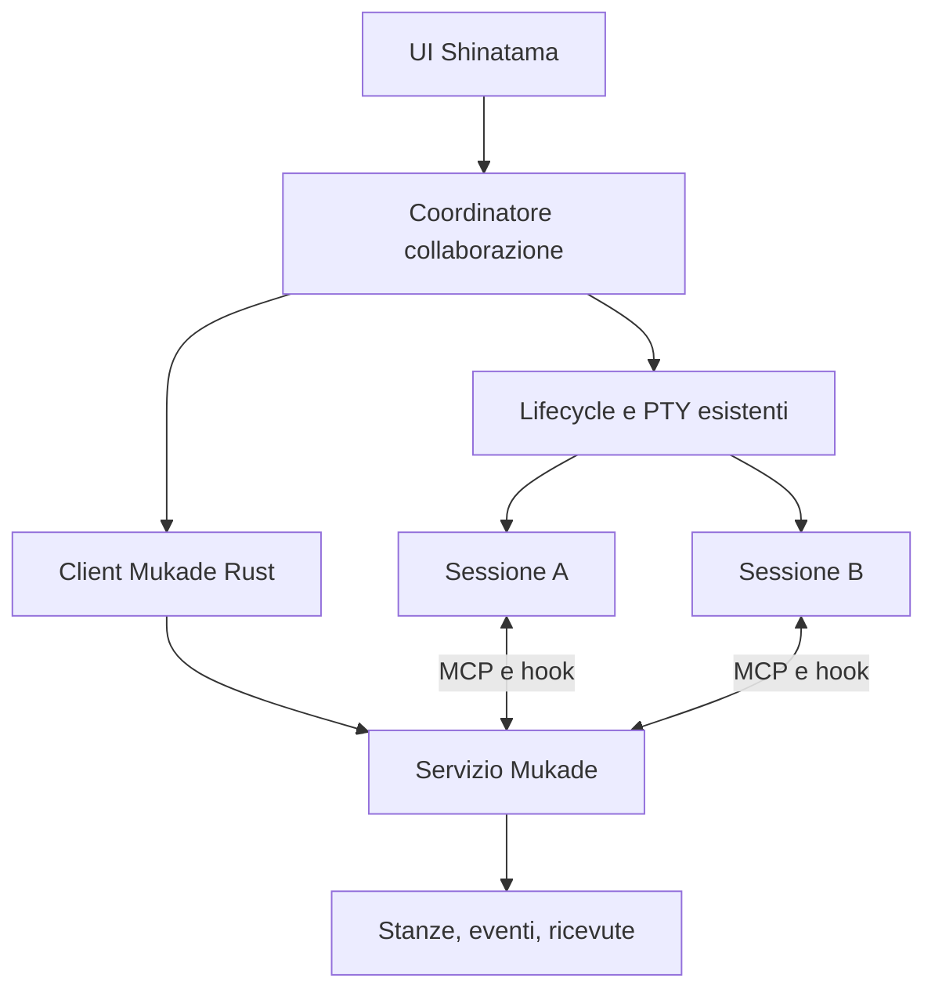
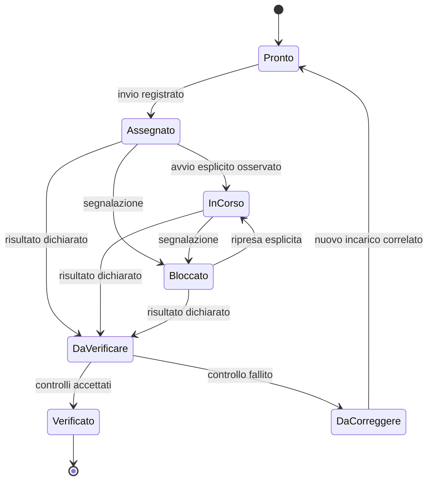

# Sessioni comunicanti con Mukade: studio di UI, codice e logica

13 novembre 2026 · Proposta da valutare, non funzionalità già integrata.

**Proposta:** aggiungere a Shinatama le **stanze di collaborazione**. Ogni stanza collega sessioni autonome, con il proprio harness, modello, contesto e terminale. Mukade gestisce partecipanti, messaggi e ricevute; Shinatama gestisce avvio, associazione ai thread, interfaccia e avanzamento del lavoro.

“Fable progetta, Qwen esegue” è un preset possibile. Il sistema deve consentire anche discussione fra pari, revisione, più esecutori e uno spiegatore che osserva.

[Apri il mockup interattivo](../mockups/mukade-collaboration.html). Usa dati dimostrativi: i controlli cambiano soltanto la rappresentazione. Modelli e risultati mostrati non attestano disponibilità o esecuzioni reali.

## 1. Che cosa c'è davvero

Lettura del working tree di Shinatama e dei sorgenti locali di `D:\Projects\mukade`. Shinatama parte da `68ebb87f154d1b4e276d6ec4987272fded7599c4` con modifiche già presenti. Le conclusioni si riferiscono ai file letti, non a una release pubblicata. Non è disponibile una mappa utilizzabile in `.daodan/map`: la ricostruzione segue sorgenti e riferimenti diretti.

| Area | Riscontro nel codice | Conseguenza |
|---|---|---|
| Sessioni Shinatama | PTY, thread, resume e lettura Mukade già esistono. Il catalogo distingue harness, non ruoli di collaborazione. [E1–E3] | Collegare le stanze a queste identità; non introdurre terminali gestiti da un secondo launcher. |
| Messaggistica Shinatama | `Messaging` e il comando CLI `shinatama mcp` implementano quattro strumenti, con store, deduplica e limiti. Non ho trovato il loro montaggio nel percorso desktop di avvio ispezionato, né i consumer nel frontend. [E4] | È codice esistente e testabile, ma non prova che due terminali desktop comunichino oggi. |
| Roundtable Shinatama | `run` usa un contratto `Headless::ask`, round e sintesi. I partecipanti sono chiamate headless nuove, non le sessioni interattive aperte. [E5] | È una funzione diversa dalla collaborazione continua; non usarla come motore delle stanze. |
| Chat Mukade | Servizio locale MCP/HTTP, 21 operazioni, stanze persistenti, quattro ruoli, ricevute e recupero. [E6–E8] | La base della comunicazione esiste già. |
| Consegna ai modelli | Adapter con hook di inizio sessione, prompt e fine turno; ascolto con durata e numero massimo di risvegli. Kit per Claude Code, Codex, OpenCode e Pi. [E9] | Configurare MCP da solo non basta a far reagire una sessione inattiva. |
| UI Mukade | La sua app desktop legge stanze, membri e messaggi dal servizio. Non crea stanze e non avvia il servizio. [E10] | Riutilizzare contratti e idee, non confondere questa UI con un'integrazione già presente in Shinatama. |
| Modelli | `Controller::open/start` riceve harness, progetto e dimensioni; non un profilo modello selezionato dalla UI. [E2] | Un selettore “Fable / Qwen” richiede un percorso reale di configurazione e verifica. |
| Revisione Mukade | `Cargo.toml` e `Cargo.lock` puntano a `694cc3f…`; `MUKADE_REVISION` e `scripts/mukade-pin.json` indicano `14edbf3…`. [E11] | Riallineare la provenienza prima dell'integrazione. Non è una prova, da sola, di un errore runtime. |

Ho eseguito `cargo test --locked --offline -p shinatama-messaging -p shinatama-roundtable --lib`: **17 test superati**. Non sono test end-to-end di collaborazione nel desktop. Non ho avviato agenti, interrogato modelli o collegato sessioni dell'utente.

Il registro live di Mukade descrive prove con Claude Code, Codex, OpenCode e Pi, più recenti di alcune frasi nel suo README. È evidenza documentale preesistente, non una prova rieseguita in questo studio. [E12]

## 2. Modello mentale e modalità

Una **sessione** è un agente concreto in esecuzione. Una **stanza** è lo spazio in cui sessioni selezionate comunicano. Un **incarico** è lavoro assegnato con un risultato atteso. Nessuno dei tre coincide con il nome del modello.

Separare sempre:

- **Nome:** “Architetto”, “Implementatore”, “Revisore”.
- **Harness:** Claude Code, Codex, OpenCode, Pi.
- **Modello e provider:** configurazione dell'istanza; Fable e Qwen sono esempi.
- **Funzione nel lavoro:** progettazione, esecuzione, revisione, spiegazione.
- **Ruolo Mukade:** permessi effettivi di comunicazione.

| Preset UI | Ruoli Mukade attuali | Uso e limite |
|---|---|---|
| Dialogo | Due o più `peer` | Domande, proposte, chiarimenti, resoconti. La funzione “progettista” non conferisce autorità tecnica. |
| Delega | Un `lead`, uno o più `worker` | Il lead invia istruzioni indirizzate. Il worker segnala soltanto `done` o `blocked`. |
| Osservazione | Uno `observer` e uno o più partecipanti con sessione associata | Lo spiegatore legge la vista ridotta; non invia messaggi in stanza. |
| Revisione | `peer` per dialogare; `worker` per un controllo strettamente delimitato | Il titolo “revisore” non è un quinto ruolo del protocollo. |

**Primo rilascio consigliato: dialogo fra peer, con funzioni nominate.** È il modo più completo di far progettare A, eseguire B e discutere un problema senza modificare il protocollo. La delega rigorosa resta disponibile per incarichi delimitati.

La limitazione dei worker è concreta: `chat_send` accetta solo lead/peer; `chat_signal(done)` non ammette un testo di risultato; `blocked` richiede una sola riga, massimo 200 caratteri. [E7] Perciò:

1. Un worker può usare `blocked` per una domanda breve, ma non sostenere una discussione.
2. L'istruzione deve indicare dove salvare il risultato; il lead lo legge e verifica dopo `done`.
3. Per una futura delega conversazionale servono nuovi eventi in Mukade, per esempio domanda e resoconto correlati all'incarico. Sono estensioni proposte, non API esistenti.

I preset sono composizioni di ruoli. Non occorre introdurre in Mukade un nuovo motore separato per ogni coppia di modelli. I ruoli sono fissi per la membership: cambiare preset su una stanza attiva non può essere un semplice cambio di etichetta.

## 3. UI proposta

### Ingresso e creazione

Nel sidebar, **Thread / Collaborazioni**. Da un terminale: **Collega a una collaborazione**. Il click su una stanza esistente la apre senza avviare modelli.

La creazione usa un pannello laterale con obiettivo, preset e partecipanti. Per ciascuno: sessione esistente oppure nuova, funzione, harness, profilo modello, cartella/worktree. La disponibilità dipende dalle capacità effettivamente verificate dell'installazione. “Aggiungi una sessione già aperta” può richiedere resume/restart se l'harness non può caricare l'integrazione durante l'esecuzione; la UI deve dirlo.

Prima dell'avvio il riepilogo rende visibili i soli effetti: nuove sessioni, cartelle, partecipanti e modalità di ascolto. Fable e Qwen non diventano opzioni codificate nel programma: sono profili selezionabili, quando configurati.

### Durante il lavoro

| Zona | Contenuto e azione principale |
|---|---|
| Sidebar | Stanze del progetto, partecipanti, incarichi bloccati e messaggi nuovi per l'utente. |
| Testata | Nome, obiettivo, stato del servizio e **Pausa nuove assegnazioni**. |
| Terminali | I terminali nativi restano visibili. Nome funzionale, harness, modello richiesto/confermato e stato del collegamento. |
| Conversazione | Solo comunicazioni deliberate della stanza, con mittente e destinatario. Filtri messaggi/incarichi/segnali. Le operazioni tecniche sono raggruppate. |
| Dettaglio incarico | Istruzione, versione del piano, responsabile, cartella, risultato atteso, artefatti e verifica. Può essere richiuso. |

Il modello richiesto e quello osservato sono dati diversi. Se l'harness non conferma il modello, mostrare “configurato, non verificato”. Anche “membro presente” e “processo in ascolto” sono dati diversi: una membership persiste quando il processo termina.

La UI deve consentire di scrivere al lead, a un membro o alla stanza senza attribuire il testo a un altro agente. Una futura presenza utente usa una propria identità di chat; l'autorizzazione a eseguire azioni resta gestita dall'host e dall'harness. Nella delega rigorosa gli incarichi passano dal lead: un messaggio diretto dell'utente non abilita il worker a rispondere liberamente o a segnalare un'istruzione di un peer.

**Tre comandi distinti:** chiudere la vista, chiudere la stanza, fermare una sessione. Chiudere la stanza non interrompe un comando già in esecuzione. “Pausa nuove assegnazioni” non promette di bloccare messaggi o tool già lanciati.

### Adattamento alla UI esistente

Conservare palette navy/cobalto/rosa, tipografia e terminali di Shinatama. Il mockup usa questi colori. La schermata storica consultata è solo un riferimento visivo: il working tree attuale contiene modifiche più recenti al sidebar.

Nella prima integrazione userei un pannello collaborazione nel work area, separato dal layout persistito dei terminali. Il modello attuale ammette un elenco chiuso di tipi e abilita solo `terminal`; aggiungere subito un pannello arbitrario al layout richiederebbe parser, persistenza e ripristino coerenti. [E3] Un pannello agganciabile come un terminale può arrivare dopo questa qualificazione.

A larghezza ridotta: dettaglio su richiesta, terminali a tab e vista conversazione espandibile. Nessuna quarta colonna permanente. Focus da tastiera, indicatori testuali oltre ai colori, mantenimento dello scroll quando arrivano eventi; autoscroll solo se l'utente è già in fondo.

## 4. Architettura e responsabilità

| Alternativa | Vantaggio | Costo | Valutazione |
|---|---|---|---|
| Estendere il bus Shinatama | Riusa le quattro operazioni e i limiti esistenti | Duplica stanze, ruoli, ricevute e adapter di Mukade | Non consigliata per questa funzione. |
| Incorporare anche il server nel desktop | Un processo da distribuire | Il servizio condiviso dipende dal ciclo di vita della finestra; coordinamento con altri client | Possibile, ma poco adatta alle sessioni indipendenti. |
| Servizio Mukade condiviso e client Rust Shinatama | Un solo responsabile delle conversazioni; riuso della CLI e degli adapter | Richiede gestione versione, disponibilità e associazioni | **Consigliata.** |

Il server è l'unico proprietario del database chat. Shinatama non usa `Bus::open` sul database di un servizio in esecuzione. L'app desktop di Mukade fornisce già un esempio di lettura attraverso `ChatClient`. [E8, E10]

**Shinatama possiede:** progetto, processi, PTY, thread, profili, associazioni stanza/sessione, incarichi applicativi e verifiche. **Mukade possiede:** membership, eventi, indirizzamento, controllo dei ruoli, batch, cursori e ricevute.

La messaggistica Shinatama esistente non va cancellata in questo studio. Per le nuove stanze si sceglie Mukade come unica fonte della conversazione; un'eventuale compatibilità con `shinatama_send` richiede un adapter esplicito, senza scrivere lo stesso messaggio in entrambi i bus. Roundtable e Hop restano funzioni distinte. La collaborazione non richiede importare o modificare transcript nativi.

### Avvio e composizione degli hook

Non basta eseguire `mukade chat launch ...` dentro un terminale generico: si aggirerebbero le associazioni e i controlli di lifecycle di Shinatama. Usare le primitive di Mukade per comporre l'integrazione dentro i launcher esistenti.

Nel percorso Claude letto, Shinatama prepara impostazioni, hook di sessione e un `mcp.json` vuoto. Mukade prepara un plugin di chat. Per Codex entrambi producono override e hook. Vanno composti mantenendo tracciamento sessione, Marionette, configurazione e confini delle home esistenti. [E2, E9, E13]

Il servizio va individuato e autenticato dal backend. Se assente, un avvio esplicito della collaborazione può avviare il binario Mukade qualificato usando `start_with_executable`: `start()` da solo usa l'eseguibile corrente, che dentro Shinatama sarebbe quello sbagliato. [E8] Chiudere una finestra non deve arrestare un servizio utilizzato da altri client. Endpoint e identità vanno riscoperti dopo un riavvio.

## 5. Logica del lavoro

### Esempio: progettazione, implementazione, revisione

1. L'utente crea una stanza e sceglie due sessioni. I ruoli funzionali sono progettista ed esecutore; entrambi peer nella variante dialogo.
2. Il progettista prepara un piano con versione, criteri di completamento e artefatti attesi. Condivide una sintesi e riferimenti precisi, non l'intero transcript.
3. L'esecutore riceve un incarico indirizzato e può chiedere chiarimenti. Il messaggio entra al confine di turno previsto dall'adapter.
4. L'esecutore produce modifiche e risultati dei controlli nel worktree assegnato, poi comunica il resoconto. Nella variante worker salva il resoconto nel percorso convenuto e invia `done`.
5. Il progettista o un revisore verifica risultato, versione del piano e controlli. Solo allora l'incarico è verificato. Un `done` non dimostra che un test sia passato.
6. Un fallimento apre una revisione o un nuovo incarico correlato. Non si riusa il medesimo evento di istruzione già concluso.

Questo è il modello applicativo **proposto**, non un'enumerazione già implementata da Mukade. Nel protocollo attuale non esiste `started`: in assenza di una prova esplicita la UI resta “assegnato”, anche se il messaggio è stato ricevuto. Annullamento e timeout vanno conservati separatamente dall'esito effettivo del processo.

### Tre stati indipendenti

| Dimensione | Esempi | Fonte |
|---|---|---|
| Connessione | da collegare, collegata, in ascolto, disconnessa, stato ignoto | Processo Shinatama + adapter, non sola membership. |
| Consegna | registrato, batch preparato, ricevuta registrata | Eventi e ricevute Mukade. |
| Incarico | assegnato, bloccato, risultato dichiarato, verificato | Contratto applicativo + segnali + verifiche. |

Gli hook sono l'unico consumer dei batch del loro membro. La UI consulta `rooms`, `members`, `ledger`; non chiama `read` e `ack` a nome dell'agente. Altrimenti può consumare un messaggio prima che arrivi al modello. `ack` attesta la ricezione del batch secondo il contratto, non la comprensione né l'esecuzione. [E6, E9, E14]

### Regole di coordinamento

- Per il primo rilascio: una stanza attiva per sessione e un incarico attivo per esecutore. L'adapter corrente salva uno stato per harness/session ID, con un solo `room_id`. [E9]
- Messaggi indirizzati quando si vuole una risposta. L'ascolto corrente risveglia su eventi indirizzati; una normale pubblicazione in stanza non è automaticamente un'interruzione. [E9]
- Nessuna copia automatica degli output terminale fra modelli. Lo spiegatore usa la proiezione ridotta; un lead che vuole anche osservare necessita di una presenza observer distinta o di un'estensione esplicita. [E6, E15]
- Piano e artefatti identificati da versione/commit/hash. Un percorso da solo non basta fra worktree diversi; il backend deve mappare la root e verificare la revisione.
- Se più sessioni scrivono sullo stesso checkout, la chat non impedisce conflitti. Preferire un worktree per esecutore; condivisione dello stesso albero solo come scelta visibile. Il risultato non è una merge automatica.
- Ripetere una mutazione incerta con lo stesso `request_id`; non reinviare automaticamente un nuovo incarico. Anche il coordinatore deve avere un registro persistente delle operazioni pendenti.
- Pausa e limiti globali richiedono enforcement condiviso se gli agenti possono chiamare direttamente MCP. I limiti del vecchio bus Shinatama non si trasferiscono a Mukade. I `max_wakes` esistenti non equivalgono a un tetto di costo globale.

## 6. Dati e contratti da aggiungere

Schema concettuale, da adattare alle migrazioni esistenti:

| Record Shinatama | Campi essenziali |
|---|---|
| `Collaboration` | ID locale, progetto, `service_id`, `room_id`, titolo, obiettivo, preset, policy, revisione |
| `ParticipantBinding` | stanza, `member_id`, thread, istanza corrente, harness, root nativa, session ID, generazione, funzione, profilo |
| `InstanceProfile` | harness, provider/modello richiesto, modello osservato e fonte, capacità chat/ascolto/osservazione, worktree |
| `WorkItem` | ID, responsabile, istruzione/evento Mukade, versione piano, dipendenze, output attesi, stato dichiarato, esito verificato |
| `PendingOperation` | request ID, operazione, payload vincolato, stato, ricevuta o esito incerto |

Gli ID evento Mukade restano stringhe in TypeScript: il protocollo rappresenta interi fino a 64 bit. Token di servizio e handle restano nel backend protetto, non nei DTO di visualizzazione. I legami usano gli ID, non nomi come “qwen” o il titolo di una scheda.

**Problema da risolvere prima dell'osservazione completa:** `StoreRoots` ha una root per harness; il server riceve quelle root. Due istanze dello stesso harness su home diverse non sono automaticamente entrambe osservabili. `source_ref` disambigua una sorgente già scoperta, non registra una nuova root. [E16] La messaggistica può funzionare senza binding nativo; per osservare tutte le home serve un registro di sorgenti autorizzate o una prima versione limitata alle root configurate.

Il servizio corrente è cooperativo sullo stesso account: il client configurato possiede la credenziale condivisa e strumenti amministrativi. Il filtro per progetto nella UI non crea isolamento forte fra agenti. Per trasferire anche il default-deny del vecchio bus occorre un controllo lato servizio o gateway con credenziali e strumenti limitati, non solo un prompt. Questa estensione va dichiarata separatamente.

### Facciata desktop proposta

`collaboration_status`, `collaboration_list`, `collaboration_snapshot`, `collaboration_create`, `collaboration_attach`, `collaboration_send`, `collaboration_pause_assignments`, `collaboration_close`.

Sono nuovi comandi Shinatama da progettare, non nomi di tool Mukade esistenti. Il backend applica scope, revisioni, capacità e idempotenza; evita un generico `call(operation, args)` esposto liberamente al frontend. Lettura iniziale a pagine, refresh limitato mentre il pannello è aperto e notifiche Tauri dal coordinatore. Non assumere che la chat attuale esponga già un flusso push completo per la UI.

## 7. Dove intervenire

| File/area | Intervento proposto |
|---|---|
| `Cargo.toml`, `Cargo.lock`, `scripts/mukade-pin.json`, `crates/engine/src/session_roots.rs` | Riallineamento del pin, compatibilità del client e provenienza di binario/reader. |
| Nuovo `crates/engine/src/collaboration/` | Client tipizzato, stato servizio, collegamenti, operazioni pendenti, proiezione degli incarichi. Primo modulo nell'engine; estrazione in crate solo se serve un riuso reale. |
| `crates/engine/src/{claude,codex,opencode,pi}_launch.rs` | Composizione dei kit, modello/profilo, env e hook; mantenimento del controllo dei processi. |
| `apps/desktop/src-tauri/src/agents.rs` e lifecycle dei singoli harness | Agganciare launch, resume, cambio native ID, fine processo e recovery ai partecipanti. |
| `crates/state/src/` | Migrazioni dei collegamenti e del registro applicativo; nessuna seconda copia autoritativa del ledger chat. |
| Nuovo `apps/desktop/src-tauri/src/collaboration.rs` e `main.rs` | Comandi ristretti e notifiche per la UI. |
| Nuovi `apps/desktop/src/collaboration.ts`, `collaboration-model.ts`, `collaboration.css` | Pannello, riduzione degli eventi, membri e incarichi. |
| `thread-sidebar.ts`, `main.ts`, `session-menu.ts` | Accesso alle stanze e collegamento delle sessioni. |
| `workspace-model.ts` e persistenza Rust corrispondente | Solo nella fase che rende la collaborazione un pannello del layout; parser, capacità e recovery insieme. |
| Mukade: `src/chat/adapter.rs`, `src/bus/chat_*` | Eventuali estensioni per stato di ascolto, multi-root, report worker e policy condivise. Nessun protocollo parallelo inventato in UI. |

La proposta richiede di aggiornare FRD-0007, ADR-0024 e i riferimenti a roundtable/proxy dopo la scelta architetturale. Non modifico qui decisioni accettate per farle sembrare già approvate.

## 8. Ordine di realizzazione e prove

| Fase | Risultato utilizzabile | Prova di accettazione |
|---|---|---|
| 0 — Fondazioni | Pin coerente; capacità di servizio, harness e modello esplicite | Identità/versione non compatibile produce stato chiaro; nessun avvio implicito da una lettura. |
| 1 — Stanze visibili | Elenco, membri, timeline e focus del terminale | UI non consuma cursori dell'agente; riavvio del servizio ricostruisce senza duplicati. |
| 2 — Dialogo reale | Due sessioni Shinatama comunicano e ascoltano | Stesso harness e harness diversi; un messaggio indirizzato arriva una volta logicamente; input utente e prompt di permesso non sono interferiti. |
| 3 — Delega | Piano, incarico, blocked/done, artefatto e verifica | Crash dopo invio, retry con request ID, risultato mancante, done senza prove, revisione del piano e worker disconnesso. |
| 4 — Gruppi e osservazione | Più esecutori, revisore e spiegatore | Worktree separati, dipendenze, root differenti, binding revocato, limiti condivisi effettivi. |

Prima di dichiarare funzionante “Fable progetta, Qwen esegue” occorre una prova su **quelle due configurazioni reali**, con piano breve, modifica su repository di prova, controllo del risultato, domanda di chiarimento e riavvio durante una consegna. Le prove esistenti su altri modelli non sostituiscono questa qualificazione.

La scelta iniziale proposta è quindi **stanze generiche + peer dialoganti + servizio Mukade condiviso**, poi incarichi verificabili. Un workflow rigido progettista/esecutore sarebbe prematuro e impedirebbe proprio gli altri scenari richiesti.

## Riferimenti del codice e limiti della verifica

Le righe indicano il working tree letto; i simboli aiutano a ritrovare il punto se i file cambiano. Tutti i nuovi tipi, comandi e stati descritti sopra sono proposte.

| Rif. | Evidenza consultata |
|---|---|
| E1 | [engine manifest](../../crates/engine/Cargo.toml), feature `session-reader`; [session_roots.rs](../../crates/engine/src/session_roots.rs), reader e protocollo metadata; [main.ts](../../apps/desktop/src/main.ts), `startSession`, avvio e resume dei thread. |
| E2 | [agents.rs](../../apps/desktop/src-tauri/src/agents.rs):351–410, `Controller::start/open/start_request`; [claude_launch.rs](../../crates/engine/src/claude_launch.rs):588–613, hook e MCP per istanza. |
| E3 | [workspace-model.ts](../../apps/desktop/src/workspace-model.ts), `ResourceReference`, `NATIVE_CAPABILITIES`, `parseWorkspaceLayout`; [thread-sidebar.ts](../../apps/desktop/src/thread-sidebar.ts), `ThreadSummary`, `ThreadSidebarOptions`. |
| E4 | [messaging/lib.rs](../../crates/messaging/src/lib.rs), `Messaging`, `deliver_due`; [cli/mcp.rs](../../crates/cli/src/mcp.rs), `Server`; [cli/main.rs](../../crates/cli/src/main.rs):7, `run_mcp`. Ricerca degli usi nel frontend, engine e shell desktop. |
| E5 | [roundtable/lib.rs](../../crates/roundtable/src/lib.rs):60, `Headless`; :208, `run`. |
| E6 | [Mukade chat_tools.rs](../../../mukade/src/bus/chat_tools.rs):89, `OPERATIONS`, `chat_tool_definitions`; [chat_domain.rs](../../../mukade/src/bus/chat_domain.rs), `chat_stream_key`. |
| E7 | [Mukade chat_mutation.rs](../../../mukade/src/bus/chat_mutation.rs):700, `send`; :805, `signal`. Ruoli, destinatari, segnale correlato, done terminale. |
| E8 | [Mukade client.rs](../../../mukade/src/chat/client.rs), `ClientConfig`, `ChatClient::connect/call/close`; [lifecycle.rs](../../../mukade/src/chat/lifecycle.rs):321, `start`, `start_with_executable`; [server.rs](../../../mukade/src/chat/server.rs), `ChatService`, `run`. |
| E9 | [Mukade adapter.rs](../../../mukade/src/chat/adapter.rs):192, `State`; :236, `role_rules`; :253, `introduction`; :408, `Kit`; :526, `listen`; :576, `handle`. [Pi kit](../../../mukade/src/chat/kits/pi.js). Letti anche i nomi dei casi in `tests/chat_adapter.rs`; non eseguiti. |
| E10 | [Mukade desktop chat.ts](../../../mukade/apps/desktop/src/chat.ts), `ChatView.poll/loadRoom`; [backend chat.rs](../../../mukade/apps/desktop/src-tauri/src/chat.rs):74, `call`; [api.ts](../../../mukade/apps/desktop/src/api.ts):49–53. |
| E11 | [Cargo.toml](../../Cargo.toml), `workspace.dependencies.mukade`; [Cargo.lock](../../Cargo.lock):1880; [mukade-pin.json](../../scripts/mukade-pin.json); [session_roots.rs](../../crates/engine/src/session_roots.rs):27, `MUKADE_REVISION`. |
| E12 | [Registro live Mukade](../../../mukade/docs/verification/2026-11-12-chat-live.md), run 1–6 e 10: risultati riportati, non rieseguiti. |
| E13 | [Mukade Claude](../../../mukade/src/harnesses/claude_code.rs), `chat_launch`; [Mukade Codex](../../../mukade/src/harnesses/codex.rs):78, `chat_launch`, trust dei soli hook selezionati; [Shinatama Codex](../../crates/engine/src/codex_launch.rs), `fixed_arguments`; [session events](../../crates/engine/src/harness_session_events.rs):91, `SessionEvent`. |
| E14 | [Mukade chat_delivery.rs](../../../mukade/src/bus/chat_delivery.rs):37, `acknowledge`; [adapter.rs](../../../mukade/src/chat/adapter.rs):349–406, lettura e ricevute degli hook. |
| E15 | [Mukade view.rs](../../../mukade/src/bus/view.rs), mascheramento, troncamento e `command_view`; [chat_tools.rs](../../../mukade/src/bus/chat_tools.rs), `observe`; [chat_domain.rs](../../../mukade/src/bus/chat_domain.rs):103, controllo observer. |
| E16 | [Mukade roots.rs](../../../mukade/src/roots.rs):14, `StoreRoots`; [chat_mutation.rs](../../../mukade/src/bus/chat_mutation.rs):469–545, `source_ref`, `resolve_binding`; [lifecycle.rs](../../../mukade/src/chat/lifecycle.rs):565, root del servizio. |

Verifica degli artefatti: JavaScript del mockup sintatticamente valido, ID HTML senza duplicati o riferimenti mancanti, 40 collegamenti del documento risolti, nessuna risorsa esterna caricata dal mockup. Non è stato possibile verificarne rendering e interazioni in un browser: Chromium Playwright non è disponibile, Edge headless non si avvia nell'ambiente e il controllo UI non espone browser. Il mockup resta una proposta da visualizzare, non un'interfaccia qualificata.

Non ho verificato runtime end-to-end, disponibilità dei provider/modelli, comportamento dei kit composti con Shinatama o tutti i percorsi di recovery del prodotto. Questi limiti sono coperti dalle prove proposte, non da un'affermazione di integrazione già completata.
